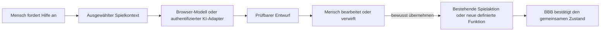

# Denkbare KI-Funktionen für das OSH-Planspiel

Stand: **6. November 2026** · Grundlage: App **0.1.0-pilot.5**.

**Status: Konzept und Vorschläge.** Keine der hier beschriebenen KI-Funktionen ist bereits in der Planspiel-App implementiert. Das Dokument dient der Auswahl und Vorbereitung möglicher Erweiterungen; es legt weder einen Modellanbieter noch einen Umsetzungstermin fest.

## 1. Ziel und Empfehlung

KI könnte helfen, gute Fragen zu stellen, Gedanken festzuhalten und Ergebnisse verständlich aufzubereiten. Das passt zum Spielziel, eine eigene Idee über sechs Lebenszyklusphasen aus unterschiedlichen Perspektiven zu betrachten. Der Austausch zwischen den Menschen bleibt der Kern des Spiels.

Für einen ersten Versuch empfehlen sich zwei Funktionen: **„Fazit formulieren“** aus ausdrücklich eingegebenen Stichpunkten und **„Impuls zur Perspektive“** als kurze Rückfrage auf Wunsch. Beide lassen sich ohne laufende Gesprächsaufzeichnung erproben. Ein darauf aufbauender **Solospiel-Begleiter** wäre besonders interessant, weil beim Spiel allein die Impulse anderer Personen fehlen.

Die vorhandene App bildet bereits Idee, Phase, Feld, Perspektive, Kartenfrage, Gruppen und gespeicherte Fazits ab. Sie enthält jedoch kein Gesprächstranskript und keine vollständigen Notizen zu jedem Zug. Eine KI kann deshalb aus dem bisherigen Spielstand allein nicht wissen, was die Gruppe mündlich besprochen hat.

## 2. Funktionen im Überblick

„Zuerst“ bezeichnet einen geeigneten Pilotumfang. Die Aufwandseinschätzung betrifft die zusätzliche App-Integration **nach** Einrichtung einer geeigneten KI-Laufzeit; sie ist keine Termin- oder Kostenzusage.

| Funktion | Nutzen und Bedienung | Benötigte Eingaben | Priorität / Aufwand |
| --- | --- | --- | --- |
| Fazit-Assistent | Spielleitung lässt Stichpunkte in ein kurzes Phasenfazit umformulieren, prüft und übernimmt den Vorschlag | Phase, Idee, eingegebene Notizen | Zuerst / überschaubar |
| Perspektiven-Coach | Aktive Person fordert eine konkrete Rückfrage zur aktuellen Perspektive an | Idee, Phase, Perspektive, gegebenenfalls aktuelle Karte | Zuerst / überschaubar |
| Solospiel-Begleiter | Liefert auf Wunsch eine Gegenposition oder Rückfrage und wartet auf die eigene Antwort | Spielkontext und bewusst eingegebene Antwort | Danach / mittel |
| Erklärhilfe für Regeln und Karten | Erklärt Begriffe und formuliert eine Karte verständlicher; Original und Erklärung bleiben getrennt sichtbar | Freigegebene Regeln, Karten-ID und Originaltext | Zuerst als Nachschlagehilfe; KI optional / überschaubar |
| Abschlussbericht | Ordnet die sechs gespeicherten Fazits nach Erkenntnissen, offenen Fragen und möglichen nächsten Schritten | Freigegebene Fazits | Danach / überschaubar |
| Sprachliche Unterstützung | Übersetzt Fragen oder bietet eine einfachere Formulierung, ohne den Originaltext zu ersetzen | Ausgewählter Text, Zielsprache oder gewünschtes Sprachniveau | Danach / mittel |
| Zusätzliche Ideenfragen | Formuliert zum eigenen Projekt passende Zusatzfragen, klar als KI-Impuls gekennzeichnet | Idee, Phase, Perspektive oder Kartenrolle | Danach / mittel |
| Blick auf Wertdimensionen | Verknüpft gespeicherte Aussagen mit den zehn vorhandenen Wertdimensionen und nennt mögliche Lücken | Freigegebene Fazits, Wertdimensionen | Danach / mittel |
| Szenario-Hilfe | Unterstützt dabei, eine erste Projektidee für das Spiel konkret zu formulieren | Eigene Stichpunkte, gewünschter Kontext | Danach / überschaubar |
| Vorher-/Nachher-Reflexion | Vergleicht bewusst festgehaltene Chancen und Bedenken vor und nach dem Spiel | Neue Vorher-/Nachher-Eingaben | Später / mittel |
| Gesprächsbasierte Notizhilfe | Erstellt Vorschläge aus einem freigegebenen Transkriptausschnitt der aktuellen Phase | Angebundene Transkription und Phasenzuordnung | Später / hoch |
| Wissenshilfe aus freigegebenen Quellen | Beantwortet Fachfragen zum OSH-Kontext mit nachvollziehbaren Quellenstellen | Redaktionell ausgewählte Wissensbasis | Später / mittel bis hoch |
| Redaktionshilfe für Spielmaterial | Markiert mögliche Kartendubletten, unklare Formulierungen und Rollenvarianten zur Prüfung durch die Redaktion | Bestehender Kartensatz und Quellenpositionen | Separates Autorenwerkzeug / mittel |

## 3. Die wichtigsten Funktionen genauer

### 3.1 Fazit-Assistent

Am Ende einer Phase warten bereits alle Figuren auf Feld 8. Die Spielleitung kann im Fazitfeld Stichpunkte sammeln und „Fazitvorschlag erstellen“ wählen. Die KI schlägt beispielsweise drei Abschnitte vor: **Erkenntnisse**, **offene Fragen** und **vereinbarte nächste Schritte**. Sind keine Schritte vereinbart, bleibt dieser Abschnitt leer oder wird ausdrücklich so bezeichnet.

Ein denkbarer Ablauf:

1. Spielleitung gibt die besprochenen Punkte ein oder wählt vorhandene, freigegebene Notizen aus.
2. Die App zeigt, welche Texte für den Vorschlag verwendet werden.
3. Der Entwurf erscheint neben dem bisherigen Text. Er erfindet keine Aussagen, Zustimmungen, Zuständigkeiten oder Termine.
4. Die Gruppe bespricht den Vorschlag; die Spielleitung bearbeitet oder verwirft ihn.
5. Erst „Als Fazit übernehmen“ und das bestehende Speichern machen ihn zum gemeinsamen Ergebnis.

**Beispiel, frei erfundene Eingabe:** „Verbindungen lösbar; Ersatzteile nachlieferbar; Tragfähigkeit noch ungetestet.“

**Passender Vorschlag:** „Wir wollen lösbare Verbindungen und nachlieferbare Ersatzteile vorsehen. Die Tragfähigkeit ist noch nicht geprüft.“

**Unpassend wäre:** „Das Regal ist nachweislich sicher, langlebig und nachhaltig.“ Dafür enthält die Eingabe keine Belege.

Die erste Fassung kann den vorhandenen lokalen Fazit-Entwurf verwenden. Gemeinsame Notizzettel während eines Zugs wären eine zusätzliche Funktion mit eigenem Datenmodell und eigenen Rechten.

### 3.2 Perspektiven-Coach

Bei analytisch, emotional, optimistisch, prozessorientiert, kreativ oder pessimistisch kann die aktive Person „Einen Impuls geben“ wählen. Die KI stellt eine kurze Frage und liefert höchstens auf weitere Nachfrage ein Beispiel. Sie soll der Gruppe Raum zum Denken lassen.

Die folgenden Fragen sind neue illustrative Beispiele für „Modular OpenShelf“, keine Originalkarten und keine festgelegte Feldfolge:

| Phase | Beispielperspektive | Möglicher Impuls |
| --- | --- | --- |
| Entwicklung | Analytisch | „Welche Anforderungen an das Modul-Regal sind bereits belegt, und welche nehmen wir bisher nur an?“ |
| Produktion | Prozessorientiert | „Welcher Fertigungsschritt müsste dokumentiert sein, damit eine andere Werkstatt das Modul nachbauen kann?“ |
| Verteilung | Optimistisch | „Welche zusätzliche Nutzergruppe könnte von einem offenen Bausatz besonders profitieren?“ |
| Nutzung | Emotional | „Was könnte jemanden bei der ersten Montage verunsichern, und wie könnten wir das auffangen?“ |
| Lebensende | Kreativ | „Welche zweite Verwendung wäre für ein einzelnes Modul möglich?“ |
| Grundlagen | Pessimistisch | „Welche Wissenslücke könnte die Weiterentwicklung durch die Community erschweren?“ |

Die Perspektive „emotional“ bezieht sich dabei auf die Fragestellung. Daraus folgt keine Erkennung oder Bewertung der tatsächlichen Gefühle von Teilnehmenden.

### 3.3 Solospiel-Begleiter und Rollenwechsel

Im Solospiel könnte eine deutlich als KI gekennzeichnete Stimme eine alternative Sicht einbringen: beispielsweise als hypothetischer Endkunde, Lieferant oder Community-Mitglied. Diese Kartenrollen sind keine realen Personen und keine feste Rollenverteilung an die Mitspielenden.

Der Begleiter erhält keine eigene Figur und belegt keinen der 1–6 menschlichen Spielplätze. Würfeln, Zugabschluss und Phasenwechsel bleiben unter menschlicher Kontrolle. Nach einer eigenen Antwort kann die KI eine kurze Nachfrage stellen; eine abschaltbare Begrenzung auf wenige Impulse pro Zug verhindert endlose Dialoge.

Im Gruppenspiel könnte dieselbe Funktion als „Andere Sichtweise“ angeboten werden. Ein KI-Beitrag wird ausdrücklich als zusätzlicher Gedanke markiert, nicht als weiterer Gruppenbeschluss.

### 3.4 Abschlussbericht und Wertdimensionen

Aus den sechs gespeicherten Fazits könnte ein Bericht entstehen: wichtigste Erkenntnisse, ungeklärte Annahmen, Widersprüche zwischen Phasen und vorgeschlagene Experimente. Jede Aussage erhält eine Herkunft, etwa „Fazit Entwicklung“ oder „Fazit Nutzung“. Neu vorgeschlagene Aufgaben werden von tatsächlich vereinbarten Aufgaben getrennt.

Eine ergänzende Ansicht könnte Aussagen den bestehenden Wertdimensionen zuordnen, etwa **Qualität & Validierung**, **Ideen mit der Community testen**, **Co-Creation & Beteiligung erleichtern** oder **Entwicklungskosten senken**. Die Zuordnung ist ein überprüfbarer Vorschlag. Ein nicht erwähnter Aspekt bedeutet nicht automatisch, dass die Gruppe ihn nicht bedacht hat.

Der Nutzen wäre ein besserer Überblick über das Projekt. Eine automatische Benotung der Personen, Rangliste der Teams oder Bewertung, welche Idee „gewinnt“, ist für diesen Ansatz nicht vorgesehen.

### 3.5 Karten- und Wissenshilfe

Für Spielregeln ist zunächst eine versionierte Suche in den freigegebenen Regeln sinnvoll; einfache Fragen benötigen keine generative KI. Ein Sprachmodell könnte gefundene Stellen verständlich erläutern. Offene Regeln müssen auch in der Antwort offen bleiben, beispielsweise die endgültige Startposition oder das Neumischen eines leeren Stapels.

Bei Fachwissen könnte die App nur freigegebene Quellen bereitstellen und die KI daraus antworten lassen. Quellen-IDs müssen gegen die tatsächlich verwendeten Dokumente geprüft werden. Wenn die Quellen keine Antwort enthalten, soll die App das sagen. Freie Websuche ist eine separate Erweiterung mit eigener Quellenprüfung und kein Bestandteil des ersten Piloten.

Zusatzfragen und sprachliche Vereinfachungen verändern weder den Originalwortlaut noch die Ziehwahrscheinlichkeit des bestehenden Kartenstapels. Für die Redaktion kann KI Dubletten markieren; die Entscheidung über die 87 Kartenpositionen bleibt eine fachliche Entscheidung.

## 4. Wie lässt sich das ohne eigenen Spielserver betreiben?

Das Grundspiel bleibt ein statisches BBB-Plugin. Generative KI benötigt jedoch eine Ausführungsumgebung für das Modell. Die vorhandenen BBB-Datenkanäle transportieren Spielereignisse; die Modellberechnung muss separat angebunden werden. Die aktuelle Planspiel-App enthält dafür keine Schnittstelle. [BBB-Plugin-Dokumentation](https://docs.bigbluebutton.org/plugins/).

| Betriebsweg | Bedeutung für den Betrieb | Zu prüfen |
| --- | --- | --- |
| Modell im Browser | Kein zusätzlicher KI-Server; Berechnung zum Beispiel nur im Browser der anfragenden Spielleitung | Modell-Download, Speicherbedarf, Browser/GPU, Ladezeit und Qualität auf den tatsächlichen Geräten |
| Modell auf demselben BBB-Server | Alles auf derselben Maschine möglich; zusätzlich zum statischen Plugin wird eine Modell-Laufzeit betrieben | Verfügbare CPU/GPU und RAM, Konkurrenz zu Konferenzdiensten, Wartung und begrenzte gleichzeitige Anfragen |
| Bereits vorhandener eigener KI-Dienst | Bestehende Infrastruktur könnte über einen kleinen serverseitigen Adapter genutzt werden | Tatsächlicher Zugang, Modellqualität, Datenweg, Verfügbarkeit und Last; zusätzlicher Dienst außerhalb des BBB-Hosts |
| Externer KI-Anbieter | Modellbetrieb liegt beim Anbieter; die App benötigt trotzdem eine geschützte Vermittlung | Datenübertragung, Nutzungsbedingungen, laufende Kosten und Ausfallverhalten |

Browser-Inferenz ist beispielsweise mit WebLLM und WebGPU grundsätzlich möglich; WebLLM unterstützt außerdem Worker zur Trennung der Modellberechnung von der Oberfläche. Ob das für die gewünschten Aufgaben auf den Teilnehmergeräten ausreichend schnell und gut ist, muss im Pilot gemessen werden. Das ist keine bereits nachgewiesene Eigenschaft unserer App. [WebLLM-Dokumentation](https://webllm.mlc.ai/docs/).

WebGPU ist nicht in jeder Browser-/Gerätekombination verfügbar und setzt einen sicheren Kontext voraus. Auch bei einem lokalen Modell müssen Herkunft, Lizenz und Download der Modelldateien festgelegt werden. „Im Browser“ allein garantiert noch nicht, dass eine gesamte Anwendung keine externen Verbindungen aufbaut. [MDN: WebGPU](https://developer.mozilla.org/en-US/docs/Web/API/WebGPU_API).

**Vorgeschlagene Entscheidung:** Zuerst den gewünschten Betriebsrahmen festlegen. Wenn kein zusätzlicher KI-Dienst gewünscht ist, einen Browser-Pilot auf den tatsächlich eingesetzten Geräten prüfen. Wenn zentraler Betrieb wichtiger ist, die Variante auf dem BBB-Server gegen dessen freie Ressourcen prüfen. Vorhandene eigene KI-Infrastruktur bleibt eine Alternative. Dieses Konzept trifft keine pauschale Modell- oder Hardwareempfehlung.

Im übergeordneten BBB-Projekt sind bereits Versuche zu Transkription und Protokollentwürfen dokumentiert. Daraus folgt keine fertig nutzbare Planspiel-Anbindung; deren Schnittstelle und Betriebsstand müssten vor einer Umsetzung erneut geprüft werden.

## 5. Konkreter Integrationsansatz

Für den ersten Fazit-Assistenten muss der bestehende `summary`-Befehl nicht durch eine KI-Aktion ersetzt werden. Der Vorschlag kann lokal neben dem Fazitfeld erscheinen. Die Spielleitung übernimmt ihn in den Entwurf und speichert anschließend wie bisher. Die Regeln zu Ankunft aller Figuren, gespeichertem Fazit und Phasenwechsel bleiben erhalten.

Ein technischer Umsetzungsentwurf wäre:

| Stelle | Vorgeschlagene Ergänzung |
| --- | --- |
| `src/app.tsx` | Schaltflächen für Hilfe, Eingabeauswahl, Entwurf, Übernehmen/Verwerfen und deutliche Kennzeichnung |
| Neue Datei, zum Beispiel `src/ai.ts` | Begrenzten Kontext zusammenstellen, Anfragen abbrechen, Antwortschema prüfen und Fehler anzeigen |
| Neue UI-Komponente | Vorschläge neben den Originaltexten darstellen; eigener Ladezustand unabhängig von `pending` für BBB-Aktionen |
| Optionaler serverseitiger Adapter | Zugriff auf Modell, Sitzung und Rolle prüfen; Anfragen begrenzen und Zugangsdaten serverseitig halten |
| `model.ts` und Protokoll | Nur dann erweitern, wenn neue gemeinsame Daten wie bestätigte Impulse oder Notizen gespeichert werden sollen |
| Tests und lokaler Prüfstand | KI zunächst durch feste Testantworten ersetzen; Antworten und Fehler unabhängig von Modellverfügbarkeit prüfen |

Eine Anfrage könnte Funktion, ausgewählte Textstellen mit Quellen-IDs, Idee, Phase, Perspektive, Sprache sowie aktuelle Spiel- und Entwurfsversion enthalten. Namen, Kamera- oder Audiodaten sind für Fazit- und Perspektivenhilfe normalerweise nicht erforderlich. Antworten enthalten getrennte Vorschläge, offene Fragen und geprüfte Quellenbezüge.

Eine verspätete Antwort darf keinen inzwischen geänderten Entwurf überschreiben. Vor dem Übernehmen werden Phase, Berechtigung und die zugrunde liegende Textversion erneut geprüft. Bei einem Präsentatorwechsel erhält die neue Spielleitung nicht automatisch Zugriff auf den privaten Browser-Entwurf der vorherigen Person; gemeinsame Entwürfe wären gesondert zu entwickeln.

Das KI-Modell löst keine Spielaktionen direkt aus. Reine Denkanstöße dürfen die Spielregeln nicht verändern. Ein gemeinsamer KI-Impuls bräuchte eine ausdrücklich definierte Aktion samt Kanal, Absenderprüfung und Replay-Verhalten; neue Ereignisse nicht ungeprüft in das bisherige Protokoll einstreuen.

Bei Nutzung eines Dienstes ist ein neues Authentifizierungskonzept erforderlich: Eine mitgesendete `userId` oder die Behauptung „Präsentator“ reicht nicht als Berechtigungsnachweis. Anbieter-Schlüssel gehören nicht in das Plugin. Bei Browser-Inferenz entfällt dieser Modell-API-Zugang, die bestehenden Rechte für gemeinsame Spielaktionen gelten weiterhin.

## 6. Gesprächsbasierte Hilfe als spätere Erweiterung

Ein Phasenfazit aus der gesprochenen Diskussion wäre attraktiv, benötigt aber mehr als den aktuellen Spielstand. Erst muss ein geeigneter Transkriptzugriff für die konkrete BBB-/SDK-Version und die vorhandene Transkriptionslösung geprüft werden. Die Verfügbarkeit von Untertiteln bedeutet nicht automatisch, dass dieses Plugin eine vollständige Historie lesen kann.

Für einen späteren Pilot sollten die Teilnehmenden sichtbar erkennen können, wann Gesprächsinhalte für die KI verwendet werden. Phasengrenzen, Unterbrechungen, unvollständige Erkennung und manuelle Korrekturen müssen berücksichtigt werden. Verwendet wird möglichst nur der benötigte Phasenausschnitt. Bei fehlenden oder widersprüchlichen Aussagen fragt die KI nach, statt einen Konsens zu erfinden.

Vor dieser Erweiterung sind Produktentscheidungen zu Aktivierung, zugänglichen Inhalten, Speicherort, Aufbewahrung und Löschung erforderlich. Rohtranskripte sollten nicht pauschal im dauernden Spielereignisstrom landen. Das ist besonders relevant, weil die gegenwärtigen Spielkanäle Ersetzen und Löschen nicht erlauben.

## 7. Qualitätsmaßstäbe

Eine Funktion ist nützlich, wenn sie das Denken und die gemeinsame Verständigung unterstützt. Für einen Pilot lassen sich folgende konkrete Fälle prüfen:

| Prüffall | Erwartetes Verhalten |
| --- | --- |
| Leere oder sehr knappe Faziteingabe | Nachfragen oder einen begrenzten Entwurf liefern; kein erfundenes Gespräch |
| Widersprüchliche Standpunkte | Unterschiedliche Positionen erhalten; keine behauptete Einigung |
| Noch unentschiedene Regel | Als offen benennen und auf den dokumentierten Stand verweisen |
| Originalfrage wird vereinfacht | Bedeutung erhalten; Original weiterhin sichtbar |
| Zwei gleiche Impulse hintereinander | Auf Wunsch eine andere Rückfrage anbieten, ohne zusätzliche Karten zu verbrauchen |
| Modell langsam oder nicht erreichbar | Grundspiel bleibt bedienbar; KI-Anfrage abbrechbar, keine doppelte Spielaktion |
| Phase oder Fazit geändert, während Antwort läuft | Antwort als überholt erkennen; nichts still überschreiben |
| Anweisungen innerhalb von Notizen oder Karten | Als Inhalt behandeln, nicht als Befehl an den KI-Dienst oder die Spielsteuerung |
| Eine falsche Quellen-ID in der Antwort | Verwerfen oder kenntlich machen; nicht als belegte Aussage ausgeben |
| Mehrere gleichzeitige Hilfsanfragen | Begrenzte Last, verständliche Wartemeldung und keine Beeinträchtigung der Konferenz |

Für die Bewertung einer kleinen Testserie können Bearbeitungsbedarf der Vorschläge, Zahl sachlich unbelegter Ergänzungen, wahrgenommener Nutzen, Antwortzeiten und Einfluss auf BBB-Audio/Video erfasst werden. Konkrete Grenzwerte werden vor dem Pilot festgelegt. Automatische Persönlichkeits-, Emotions- oder Leistungsprofile sind für diese Funktionen nicht erforderlich.

## 8. Vorschlag für die Umsetzung in Etappen

**Etappe 1: Textbasierter Pilot.** Betriebsweg auswählen, ein begrenztes Modell-/Adapterexperiment durchführen und Fazit-Assistent sowie Perspektiven-Coach mit ausdrücklich eingegebenem Text erproben. Keine automatische Übernahme, keine laufende Gesprächserfassung. Das Spiel funktioniert vollständig weiter, wenn KI ausgeschaltet ist.

**Etappe 2: Spielbegleitung und Ergebnisaufbereitung.** Solospiel-Begleiter, verständliche Karten-Erklärungen und Abschlussbericht ergänzen. Bei Bedarf Übersetzung und die Zuordnung zu Wertdimensionen hinzufügen. Erst anhand der Pilotergebnisse entscheiden, welche Funktionen dauerhaft sinnvoll sind.

**Etappe 3: Erweiterter Kontext.** Vorher-/Nachher-Reflexion mit eigenen Eingabefeldern, freigegebene Wissensquellen und gegebenenfalls Transkriptanbindung entwickeln. Die Materialredaktion kann unabhängig davon ein separates Autorenwerkzeug erhalten.

Vor der ersten Implementierung sind vor allem drei Fragen zu entscheiden: Welche ein bis zwei Funktionen starten? Wo darf die Modellberechnung laufen? Welche Inhalte sollen dafür bewusst bereitgestellt werden? Dieses Dokument beantwortet die möglichen Wege, setzt diese Entscheidungen aber nicht voraus.

## 9. Bezug zur bestehenden Dokumentation

- [Implementierungs-How-to](osh-planspiel-implementierung-howto.md): Quellcode, Ereignisse, Rollen und Release-Erstellung.
- [Stand und Abnahme](stand-und-abnahme.md): tatsächlich vorhandene Funktionen und bekannte Grenzen.
- [Bedienung und Spielregeln](osh-planspiel-bedienungsanleitung-online.md): Ablauf der Online-Version.
- [Changelog](../CHANGELOG.md): Konzepte und ausgelieferte App-Änderungen getrennt nachverfolgen.

Die technischen Quellen zu BBB, Browser-Inferenz und WebGPU wurden am 6. November 2026 gelesen. Sie belegen mögliche Bausteine; eine Kompatibilitäts- oder Leistungsprüfung mit dem Planspiel ist damit noch nicht erfolgt.
