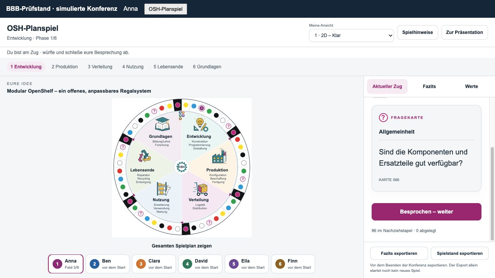
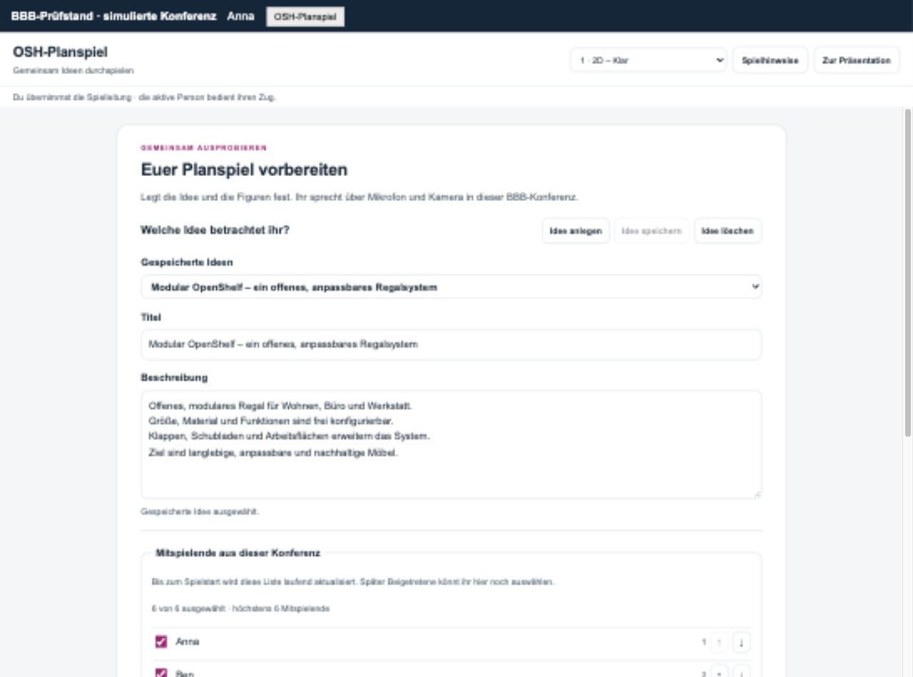
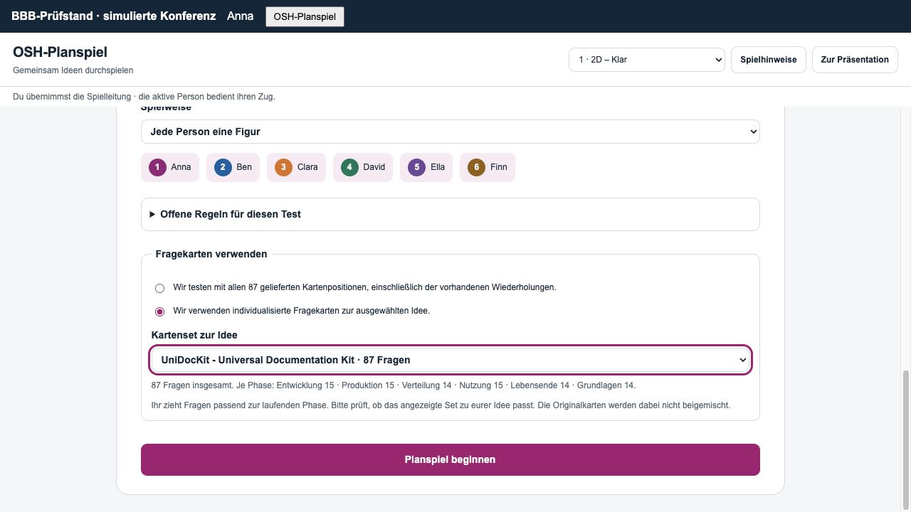

# OSH-Planspiel online

**Bedienungsanleitung und Spielregeln**

Online-Version **0.1.0-pilot.13** · Stand: 10.11.2026

Die vier zusätzlichen Kartensets dieser Fassung sind lokal geprüft und zur Aktivierung in Beispielraum A und Beispielraum B vorbereitet. [Update und Aktivierung](osh-planspiel-update-vier-ideen-2026-11-10.md).

## Gemeinsam eine Idee durchspielen

Ihr betrachtet eine Idee für offene Hardware aus unterschiedlichen Blickwinkeln und entlang ihres Lebenszyklus. Ziel dieser Besprechungsfassung sind **sechs gemeinsam formulierte Fazits**. Es gibt derzeit keine automatische Punktewertung und keine Siegerermittlung.

Das Spiel läuft im Präsentationsbereich von BigBlueButton (BBB). Ihr sprecht über die Videokonferenz und seht denselben Spielstand. **1 bis 6 Personen** können mitspielen. Auch allein ist es möglich; dann fehlen die Impulse anderer Personen.

*Ansicht aus dem lokalen Browserprüfstand. Die BBB-Umgebung kann anders aussehen; die Bedienung innerhalb des Spiels ist gleich.*

## In vier Schritten loslegen

1. Gemeinsam Beispielraum A beitreten und im Apps-Bereich **OSH-Planspiel** öffnen.
2. Die Spielleitung wählt Idee, Mitspielende und Spielweise und startet das Spiel.
3. Die jeweils aktive Person würfelt. Alle diskutieren die Perspektive oder Frage; die aktive Person bestätigt den Zug.
4. Alle warten am Phasenende. Die Spielleitung speichert euer Fazit und beginnt die nächste Phase. Zum Schluss die Ergebnisse exportieren.

<!-- pagebreak -->

## Ideen für euren Konferenzraum verwalten

Neben „Welche Idee betrachtet ihr?“ stehen drei Buttons. Darunter wählt ihr eine bereits gespeicherte Idee anhand ihres Titels aus.

- **Idee anlegen:** Öffnet einen leeren Entwurf für Titel und Beschreibung.
- **Idee speichern:** Speichert eine neue Idee oder Änderungen an der ausgewählten Idee dauerhaft für diesen Raum. Die Bestätigung abwarten.
- **Idee löschen:** Entfernt die ausgewählte Idee nach einer zusätzlichen Bestätigung.

Ein neuer Raum erhält einmalig „Modular OpenShelf – ein offenes, anpassbares Regalsystem“ mit einer kurzen Beschreibung aus dem Präsentationsbeispiel. Der Community-Aspekt bleibt bewusst offen für die Diskussion. Gelöschte Beispiele werden nicht automatisch wieder angelegt.

Der Titel ist einzeilig, die Beschreibung mehrzeilig. Änderungen bleiben bis zum Speichern ein Entwurf. Beim Wechsel einer Idee könnt ihr ungespeicherte Änderungen verwerfen oder weiterbearbeiten. Bei einer Fehlermeldung bleibt der Text erhalten; nach einem Konflikt die Liste aktualisieren und den Entwurf prüfen.

Gespeicherte Ideen stehen nach einer neuen Konferenz im selben Raum erneut bereit. Andere Räume haben eigene Ideenbestände. Es gibt keine Import-/Exportfunktion für die Ideenliste. Zum Spielen darf auch ein ungespeicherter Entwurf verwendet werden; für spätere Runden zuerst speichern.

Beim Spielstart erhalten alle Teilnehmenden dieselbe Kopie von Titel und Beschreibung. Die Beschreibung lässt sich unter dem Ideentitel aufklappen. Eine später bearbeitete Vorlage ändert keine bereits begonnene Partie.

*Ideenverwaltung im lokalen Browserprüfstand; nur für die Spielleitung sichtbar.*

<!-- pagebreak -->

## 1. Vorbereiten und Mitspielende aufnehmen

Die **Spielleitung ist die Person mit BBB-Präsentationsrecht**. Das muss nicht dieselbe Rolle wie die BBB-Moderation sein. Ohne Präsentationsrecht seht ihr vor dem Spielstart den Hinweis „Der Präsentator startet das Spiel“ und wartet auf die gemeinsame Spielansicht.

1. Die Spielleitung wählt unter „Welche Idee betrachtet ihr?“ eine gespeicherte Idee oder legt eine neue an. Titel und Beschreibung sind getrennte Felder.
2. Unter „Mitspielende aus dieser Konferenz“ erscheinen die aktuellen BBB-Namen. Bis zu sechs Personen sind vorausgewählt. Mit den Kästchen wählt ihr aus, wer tatsächlich mitspielt.
3. **Später Beigetretene können vor dem Start noch aufgenommen werden.** Die Liste aktualisiert sich laufend. Eine bewusst getroffene Auswahl bleibt erhalten; neue Personen lassen sich hinzufügen. Sind bereits sechs ausgewählt, zuerst jemanden abwählen. Erst „Planspiel beginnen“ legt die Besetzung fest.
4. Mit den Pfeilen neben den Namen ändert ihr die Reihenfolge. Diese bestimmt die Figuren- und Teamzuordnung. Die Vorschau zeigt, wer zu welcher Figur gehört.
5. Unter „Spielweise“ wählt ihr eigene Figuren oder eine passende Teamaufteilung.

| Mitspielende | Eigene Figuren | Teamvarianten |
| --- | --- | --- |
| 1 | Eine Figur; Solospiel | Keine |
| 2 | Zwei Figuren | Keine |
| 3 | Drei Figuren | Keine |
| 4 | Vier Figuren | Zwei 2er-Teams |
| 5 | Fünf Figuren | Ein 2er-Team und ein 3er-Team |
| 6 | Sechs Figuren | Drei 2er-Teams oder zwei 3er-Teams |

6. Unter „Offene Regeln für diesen Test“ wählt die Spielleitung die **Startposition**: vor dem ersten Feld oder auf dem ersten Feld. Diese Auswahl gilt in allen sechs Phasen. Standard ist „Vor dem ersten Feld“.
7. Wählt **87 Originalkarten** oder **individuelle Fragen** mit passendem Set. Danach **Planspiel beginnen** anklicken.

**Vor dem Klick prüfen:** Stimmen Idee, Namen, Reihenfolge und Teams? Nach dem Start werden keine zusätzlichen Spielplätze angelegt und die Teamaufteilung bleibt bestehen. Ein späterer Konferenzbeitritt ist weiterhin möglich; die Person kann zuschauen und mitdiskutieren.

## Wer bedient was?

| Person | Bedienung |
| --- | --- |
| Spielleitung | Vorbereitung, Spielstart, gemeinsame Fazits, Phasenwechsel und Abschluss |
| Aktive Person | Würfeln, optionale Zusatzfrage im eigenen Zug, „Besprochen - weiter“ |
| Übrige Personen | Gemeinsame Ansicht, Diskussion, Fazits und Wertdimensionen lesen; Ergebnisse exportieren |

Die Spielleitung kann selbst mitspielen. Dann bedient sie ihren eigenen Zug wie jede andere Person. **Die BBB-Präsentatorrolle wechselt beim Spielerwechsel nicht.**

<!-- pagebreak -->

## 2. Spielplan, Perspektiven und Karten

Der Rundkurs besteht aus **48 Feldern: sechs gleich großen Sektoren mit jeweils acht Feldern**. Jeder Sektor entspricht einem Sechstel des Spielplans (60° in der Brettebene). Die Online-Version durchläuft die Phasen in dieser Reihenfolge:

| Reihenfolge | Phase | Themen auf dem Spielplan |
| --- | --- | --- |
| 1 | Entwicklung | Konstruktion, Programmierung, Gestaltung |
| 2 | Produktion | Konfiguration, Beschaffung, Fertigung |
| 3 | Verteilung | Logistik, Distribution |
| 4 | Nutzung | Erweiterung, Verwendung, Wartung |
| 5 | Lebensende | Reparatur, Recycling, Entsorgung |
| 6 | Grundlagen | Bildung/Lehre, Forschung |

### Perspektivfelder

Die Farbe eines Felds gibt vor, aus welchem Blickwinkel ihr eure Idee besprecht. Die nachfolgenden Impulse sind Verständnishilfen für die Online-Runde.

| Farbe | Perspektive | Möglicher Gesprächsimpuls |
| --- | --- | --- |
| Weiß | Analytisch | Welche Fakten kennen wir? Welche Informationen fehlen? |
| Rot | Emotional | Welche Gefühle, Wünsche oder Bedenken entstehen? |
| Gelb | Optimistisch | Welche Chancen und Vorteile sehen wir? |
| Blau | Prozessorientiert | Wie organisieren wir die nächsten Schritte? |
| Grün | Kreativ | Welche neuen Ideen oder Alternativen fallen uns ein? |
| Schwarz | Pessimistisch | Welche Risiken, Schwächen oder Hindernisse erkennen wir? |

<!-- pagebreak -->

## Fragekarten auswählen und verwenden

Unter **Fragekarten verwenden** stehen zwei alternative Optionen. Bei **individualisierten Fragekarten** prüft ihr das **Kartenset zur Idee**. OpenShelf und UniProKit Maxi enthalten unverändert je 47 Fragen. USB-C-Werkzeug-Akkusystem, Kindergarten-Laubkompost, OSEG-Ideenplattform und UniDocKit enthalten je 87 Fragen. Die Auswahl gilt für alle Teilnehmenden und bleibt nach dem Start festgelegt.

*Lokaler Browserprüfstand: Individuelle Karten stehen direkt unter der Originalauswahl.*

Der **Originalstapel** enthält 87 Kartenpositionen und wird über alle Phasen hinweg verwendet. Die beiden bisherigen Sets haben acht Fragen je Phase, sieben bei Grundlagen. Die vier neuen 87er-Sets haben je 15 Fragen in Entwicklung, Produktion und Nutzung sowie je 14 in Verteilung, Lebensende und Grundlagen. Ihr zieht daraus nur Fragen zur laufenden Phase, ohne Wiederholung. Nicht gezogene Karten vergangener Phasen werden später nicht nachgeholt. Ist der Phasenvorrat leer, diskutiert ihr ohne weitere Karte; Fazit und Phasenwechsel funktionieren weiterhin. Die Anzeige unterscheidet Phasenvorrat und Gesamtstapel.

Ein **pinker Kreis mit Fragezeichen** kennzeichnet ein reguläres Fragefeld. Beim Landen zieht die App automatisch eine Fragekarte, solange für die Phase eine Karte verfügbar ist. Die Karte erscheint neben dem Spielplan. Lest die Frage und besprecht sie im Zusammenhang mit eurer Idee und der aktuellen Phase.

Die Rollenbezeichnung auf der Karte liefert eine Perspektive für die Frage. Sie weist den Mitspielenden **keine feste persönliche Rolle** zu. Es ist immer nur eine Karte gleichzeitig offen. Bei „Besprochen - weiter“ wird sie auf den Ablagestapel gelegt.

Während einer Besprechung kann die zuständige Person mit **Zusätzliche Frage ziehen** freiwillig eine Karte aufdecken, sofern keine Karte offen und für die Phase noch eine Karte verfügbar ist. Im gemeinsamen Phasenabschluss bedient diese Funktion die Spielleitung. Eine bereits offene Karte wird dadurch nicht ersetzt.

<!-- pagebreak -->

## 3. Ein Spielzug und der gemeinsame Phasenabschluss

### So läuft ein Zug ab

1. Die App zeigt den Namen der aktiven Person. Nur diese Person sieht **Würfeln**. Bei Teams steht zusätzlich dabei, für welches Team sie diesen Zug bedient.
2. Ein Klick würfelt eine Zahl von **1 bis 6**. Die Figur wird automatisch bewegt; ihr müsst sie nicht ziehen oder selbst Felder zählen.
3. Besprecht gemeinsam die angezeigte Perspektive oder Frage in der Videokonferenz. Auch die gerade nicht aktiven Personen bringen ihre Gedanken ein.
4. Wenn ihr fertig seid, klickt die aktive Person auf **Besprochen - weiter**. Erst dann endet der Zug und die nächste noch nicht wartende Figur ist dran.

**Belegte Zielfelder:** Ist ein reguläres Zielfeld durch eine andere Figur besetzt, rückt die App auf das nächste freie Feld innerhalb derselben Phase weiter. Spätestens auf Feld 8 wird angehalten.

**Zu hohe Würfelzahl:** Eine Figur auf Feld 6, die eine 5 würfelt, endet auf Feld 8. Überzählige Schritte verfallen; sie werden nicht in die nächste Phase übertragen. Bestätigt auch diesen Zug nach eurer Besprechung. Die Figur wartet danach und würfelt in dieser Phase nicht mehr. Auf Feld 8 dürfen mehrere Figuren stehen. Seine pinke Markierung löst keine automatische Zusatzfrage aus.

### Wer bedient die gemeinsame Teamfigur?

Ein Team hat eine Figur. Seine Mitglieder wechseln sich **nach jedem abgeschlossenen Zug der Teamfigur** in der angezeigten Reihenfolge ab. Die aktive Person bedient den gesamten Zug, also Würfeln, gegebenenfalls eine Zusatzfrage und die Bestätigung.

Beispiel: Anna, Ben und Clara bilden Team 1. Anna bedient dessen ersten Zug, Ben dessen nächsten, dann Clara. Dazwischen sind die anderen Figuren an der Reihe. Die Teamreihenfolge bleibt über die Phasengrenze erhalten. Hat zuletzt Ben bedient, ist beim nächsten Zug dieser Figur Clara dran. Ein am Phasenende wartendes Team wird bis zur nächsten Phase übersprungen.

### Erst gemeinsam abschließen, dann weitergehen

1. Wenn **alle Figuren auf Feld 8** angekommen und die letzten Besprechungen bestätigt sind, zeigt die App „Alle sind angekommen“.
2. Fasst die wichtigsten Erkenntnisse dieser Phase gemeinsam zusammen. Über „Werte“ könnt ihr die Wertdimensionen als Gesprächshilfe nachlesen. Eine Zusatzfrage ist freiwillig; eine offene Frage muss vor dem Phasenwechsel abgeschlossen werden.
3. Die Spielleitung trägt das Ergebnis in **Gemeinsames Fazit** ein und klickt auf **Fazit speichern**. Erst die Speicherbestätigung zeigt, dass der Text im gemeinsamen Spielstand angekommen ist. Die übrigen Personen sehen das gespeicherte Fazit.
4. Mit **Gemeinsam zur nächsten Phase** setzt die Spielleitung fort. Dafür muss ein nicht leeres Fazit gespeichert sein. Wenn der Text danach noch geändert wurde, zuerst erneut speichern.

Zu Beginn jeder neuen Phase stehen alle Figuren wieder an der gewählten Startposition. Die erste Figur beginnt; die abwechselnde Bedienung innerhalb der Teams wird fortgesetzt. Nach Phase 6 heißt die Schaltfläche **Spiel abschließen**. Danach könnt ihr alle sechs Fazits gemeinsam ansehen und exportieren.

<!-- pagebreak -->

## 4. Ansichten, Ergebnisse und Hilfe

### Die Oberfläche bedienen

- **Aktueller Zug** zeigt aktive Person, Würfelzahl, Perspektive oder Karte und die passenden Bedienknöpfe.
- **Fazits** zeigt alle gespeicherten Zusammenfassungen. **Werte** zeigt die Wertdimensionen als Gesprächshilfe.
- Die **Ansichtsauswahl oben** bietet sechs persönliche Varianten: **1 – 2D – Klar**, **2 – 2D – Werkstatt**, **3 – 2D – Dialog**, **7 – 3D – Bitmap-Tischmodell**, **8 – 3D – Bitmap-Werkstatt** und **9 – 3D – Bitmap-Spiellandschaft**. Die bisherigen Ansichten 4–6 sind entfernt; eine gespeicherte Auswahl wird automatisch auf die entsprechende Bitmap-Variante umgestellt. 7–9 zeigen das ganze illustrierte Brett auf einer passenden Tischfläche mit plastischem Kartenbereich. Jede Person kann unabhängig wählen, auch ohne Präsentationsrecht. Die eigene Auswahl ändert weder den Spielstand noch die Ansicht anderer Personen.
- In den Tischszenen 7–9 zeigt der Kartenstapel die verbleibenden Karten, der ruhende räumliche Würfel den letzten bestätigten Wurf auf seiner Oberseite. Auch beide sichtbaren Seitenflächen tragen Augen. Vor dem ersten Wurf steht ein Fragezeichen. Beide sind Anzeigen; bedient wird der Zug über die gewohnten Knöpfe im Kartenbereich. Bei wenig Platz werden die Requisiten ausgeblendet. **Gemeinsames Fazit** öffnet die Fazitübersicht. Längere Karten lassen sich rechts scrollen.
- In 3D bewegen sich Hütchen auf dem Brett; in 2D bleiben die runden Spielfiguren. Auf den 3D-Feldern stehen keine Feldnummern. Alle Ansichten verwenden dieselben acht Felder je Phase.
- **Gesamten Spielplan zeigen** bzw. **Rundkurs vergrößern** ändert bei Ansicht 1–3 den Bildausschnitt. In den Bitmap-Ansichten 7–9 zeigt **Legende einblenden** die Perspektiven und Feldarten; **Legende ausblenden** schafft mehr Platz für das Brett. Alle räumlichen Ansichten haben eine feste Perspektive. Die rechte Seitenleiste erhält in 3D einen dezenten schwebenden Effekt.
- Die Auswahl bleibt im Browser für eure BBB-Kennung gespeichert. Nach Neuladen oder Wiederöffnen wird sie wiederhergestellt. Eine neue Kennung oder gelöschter beziehungsweise gesperrter Browserspeicher kann die Auswahl zurücksetzen.
- **Spielhinweise** zeigt eine Kurzerklärung. **Zur Präsentation** schließt die Ansicht ohne Datenverlust: bei der Spielleitung für alle, sonst nur für euch selbst. Über den Apps-Bereich öffnet ihr sie wieder.

### Ergebnisse sichern

**Fazits exportieren** lädt eine Markdown-Datei mit Idee, Namen, Figuren und Fazits herunter. **Spielstand exportieren** lädt den aktuellen Zustand als JSON-Datei herunter. Beides können alle Personen bedienen.

**Exportiert vor dem Ende der BBB-Konferenz.** Der gemeinsame Spielstand gehört zur aktuellen Konferenz. Ein Neuladen innerhalb derselben laufenden Konferenz stellt bestätigte Aktionen wieder her. Ein noch nicht gespeicherter Fazitentwurf kann dabei verloren gehen. Ein Export lässt sich in dieser Fassung noch nicht wieder importieren; er setzt kein neues Spiel fort. Für eine neue Partie wird eine neue BBB-Konferenz benötigt.

### Wenn etwas nicht wie erwartet aussieht

| Situation | Vorgehen |
| --- | --- |
| Vor dem Start sind keine Auswahlen sichtbar | Warteansicht: Nur die Person mit BBB-Präsentationsrecht bereitet das Spiel vor. |
| „Planspiel beginnen“ ist gesperrt | Teilnehmerauswahl und Idee prüfen, Kartenmodus und gegebenenfalls passendes Set auswählen und BBB-Verbindung abwarten. |
| „Würfeln“ fehlt | Aktiven Namen prüfen. Nur diese Person bedient den Zug. Angekommene Figuren warten. |
| Eine Person hat die Verbindung verloren | Rückkehr abwarten. Bei neuer BBB-Kennung nutzt die Spielleitung „Abwesende Mitspielende neu zuordnen“ für den bestehenden Platz. |
| BBB bestätigt eine Aktion noch nicht | Verbindung prüfen; keine automatische Wiederholung. Bei Bedarf dieselbe laufende Konferenz neu laden und den Spielstand prüfen. |

### Regeln und Grenzen der aktuellen Testfassung

- **Startposition:** Noch nicht endgültig festgelegt; die Auswahl vor dem Spiel gilt für die gesamte Partie.
- **Karten:** Originalstapel mit 87 Positionen einschließlich Wiederholungen oder ein individuelles Set mit 47 beziehungsweise 87 Fragen. Die Auswahl gilt für die gesamte Partie. Bei leerem Phasenvorrat ohne weitere Karte diskutieren; kein automatisches Neumischen.
- **Phasenabschluss:** Das gemeinsame schriftliche Fazit ist verbindlich. Eine zusätzliche Abschlussfrage pro Person wird nicht automatisch erzwungen.
- **Wertung:** Münzen, Münzvergabe per Gruppenkonsens und Vorher-/Nachher-Auswertung sind noch nicht umgesetzt. Es gibt keinen berechneten Punktestand.
