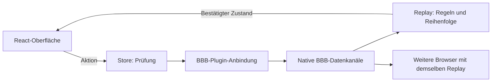

# How-to: OSH-Planspiel als BBB-App implementieren und erweitern

> Betriebsangaben sind anonymisierte Beispiele. [Platzhalter und Übertragung auf eine eigene Instanz](datenschutz-und-betriebsbeispiele.md) vor der Ausführung beachten.

Stand: **10. November 2026** · dokumentierter Quellstand: **0.1.0-pilot.13** (lokal geprüft, Aktivierung offen; zuletzt live bestätigt: pilot.5) · Ereignisprotokoll: **3** (Originalhistorien mit Protokoll 2 lesbar).

Dieses How-to führt durch den vorhandenen Quellcode: lokal bauen, einen gemeinsamen Spielzug nachvollziehen, Änderungen implementieren, prüfen und als BBB-Plugin ausliefern. Es setzt Grundkenntnisse in TypeScript, React und Terminalbefehlen voraus. Das Dokumentationsrepository enthält diese Anleitung; für die Befehle wird zusätzlich die Arbeitskopie des Anwendungsprojekts mit `apps/osh-planspiel/` benötigt.

## 1. Was wird implementiert?

Die Anwendung ist ein Browser-Plugin für BigBlueButton. React zeichnet die Oberfläche im BBB-Hauptbereich. Die bestehenden BBB-Datenkanäle verteilen Spielereignisse. Die Spielereignisse benötigen keine eigene Spielstanddatenbank. Zusätzlich zu den statischen Plugin-Dateien läuft seit pilot.11 ein kleiner Python-Dienst auf demselben BBB-Server, der die Ideenvorlagen je Raum dauerhaft in einer JSON-Datei speichert.



Das Ergebnis ist ein gemeinsamer Spielstand innerhalb einer Konferenz. Video und Audio bleiben BBB-Funktionen. Die App vergibt beim Zugwechsel keine Präsentationsrechte.

## 2. Entwicklungsumgebung vorbereiten

Benötigt werden die Anwendungsquellen, Node.js mit npm sowie für die Installerprüfung Python 3 und Ruby. Am 6. November 2026 wurden die Befehle mit Node **20.20.2**, npm **10.8.2**, Python **3.14.4** und Ruby **2.6.10** ausgeführt. Dies sind die vorhandenen Prüfversionen, keine Empfehlung für die Lebensdauer einer Serverinstallation. Eine andere Node-Version muss den verwendeten `node --import tsx`-Aufruf unterstützen und dieselben Prüfungen bestehen.

Vom Stammverzeichnis der Anwendungsarbeitskopie:

```sh
cd apps/osh-planspiel
npm ci
npm run typecheck
npm test
npm run build
```

`npm ci` installiert die im Lockfile festgelegten Abhängigkeiten. Bei bereits eingerichteter Arbeitskopie beginnt der normale Änderungszyklus mit Typprüfung und Tests. Ein automatischer Build-Watcher ist derzeit nicht eingerichtet: Nach Quellcodeänderungen erneut bauen und die Browseransichten neu laden.

Die wichtigsten festgelegten Pakete sind React/React DOM **18.3.1**, TypeScript **5.9.3**, esbuild **0.25.12** und `bigbluebutton-html-plugin-sdk` **1.0.0-beta.3**. Das Manifest verlangt genau diese SDK-Version. Bei einem SDK-Wechsel müssen Quellcode, Manifest, Installerprüfung und BBB-Abnahme gemeinsam angepasst werden.

Nach dem Build muss folgendes Verzeichnis vorhanden sein:

```text
dist/plugin/
├── OshPlanspielPlugin.js
├── manifest.json
├── release.json
└── boards/
    ├── spielplan-klar.svg
    ├── spielplan-werkstatt.svg
    ├── spielplan-dialog.svg
    ├── 3d-tischmodell.png
    ├── 3d-werkstatt.png
    ├── 3d-spiellandschaft.png
    ├── table-tischmodell.png
    ├── table-werkstatt.png
    └── table-spiellandschaft.png
```

Die JSON-Dateien mit Originalkarten, sechs individuellen Kartensets, Spielplan und Figurenmodi werden über TypeScript-Imports in das JavaScript eingebunden. Die drei SVG-Spielpläne, drei PNG-Brettillustrationen und drei PNG-Tischoberflächen werden als separate Dateien kopiert. Das Release umfasst zwölf Dateien; der Build leert sein eigenes Ausgabe-Verzeichnis, damit keine alten Assets mitgeliefert werden. `npm run build` installiert nichts auf BBB.

## 3. Im Quellcode orientieren

Alle folgenden Pfade beziehen sich auf `apps/osh-planspiel/` in der Anwendungsarbeitskopie.

| Datei | Aufgabe | Hier ändern, wenn … |
| --- | --- | --- |
| `src/plugin.tsx` | Einstieg, BBB-Hooks, App-Galerie, Hauptbereich, Senden und Bestätigen | sich die BBB-Anbindung oder der Transport ändern soll |
| `src/model.ts` | Zustand, Aktionen, Regeln, Rechte, Replay, Fazitexport | sich Spielregeln oder gemeinsame Daten ändern |
| `src/store.ts` | React-Abonnement und Prüfung vor dem Senden | lokale Voraussetzungen oder Sperren angepasst werden |
| `src/participants.ts` | BBB-Personenliste, Vorauswahl, Startprüfung | Auswahl, Namensanzeige oder Anwesenheitsprüfung geändert werden |
| `src/random.ts` | BBB-verträglicher Mischwert | Zufallswerte für den Kartenstapel geändert werden |
| `src/card-sets.ts` / `content/personalized/*.de.json` | Kartensets, Titelvorschläge und Phasenzuordnung | individuelle Karten ergänzt werden |
| `src/idea-editor.tsx` / `src/ideas.ts` | Ideenformular und authentifizierter Speicherzugriff | die Ideenverwaltung angepasst wird |
| `server/ideas.py` | Raumbezogene JSON-Datei, BBB-Rechteprüfung und Schreibkonflikte | dauerhafte Ideen gespeichert werden |
| `content/default-idea.de.json` | Erstvorlage für neue Räume | der vorausgefüllte Text geändert wird |
| `src/app.tsx` | Vorbereitung, Spielfeld, Karten, Würfeln, Fazits und Export | die Bedienung oder Darstellung geändert wird |
| `src/views.ts` | Sechs persönliche Ansichten (1–3, 7–9), Migration entfernter IDs und lokale Speicherung je BBB-Kennung | eine Ansicht ergänzt oder ihre Speicherung geändert wird |
| `src/board.tsx` | 2D-/3D-/Bitmap-Darstellung, Illustrationen und Figurenformen | Brett oder Hütchen geändert werden |
| `src/board-geometry.ts` | Gemeinsame Figurenfarben und Positionen für 2D | Geometrie oder Figurengruppen angepasst werden |
| `src/bitmap-geometry.ts` | Zuschnitte, Silhouetten und 48 Markermittelpunkte je Bitmap | ein Bitmap-Spielplan geändert wird |
| `src/board-contour.ts` | Glatte Alpha-Maske aus vermessenen Konturpunkten | der Übergang zwischen Brett und Tisch korrigiert wird |
| `src/die.tsx` | Perspektivischer Würfel, konsistente Flächenrotation, Licht und Augen | die Darstellung des bestätigten Wurfs geändert wird |
| `src/table-accessories.tsx` | Sichtbarer Kartenstapel und bestätigter Würfelwert in 7–9 | Tischrequisiten gestaltet werden |
| `src/styles.css` | Gestaltung Klar, Werkstatt, Dialog und kleine Ansichten | Layout oder Farben geändert werden |
| `content/*.json` | Karten, Felder, Figurenmodi und Zusatzmaterial | Spielinhalte angepasst werden |
| `designs/boards-v1/*.svg` | Hintergrundgrafiken des Spielplans | die gezeichneten Spielpläne geändert werden |
| `designs/boards-3d/*.png` | Vollständige Brettillustrationen in 7–9 | räumliche Gestaltung geändert wird |
| `designs/table-surfaces-v1/*.png` | Leere Tischoberflächen für die bestehenden Bitmap-Ansichten 7–9 | das Umfeld neu gestaltet wird |
| `scripts/build.mjs` | Bundle, Manifest und Integrität | zusätzliche Assets oder Manifestfelder gebraucht werden |
| `scripts/fixture.mjs` | Lokaler BBB-Prüfstand | Entwicklungsszenarien erweitert werden |
| `scripts/package.mjs` | Archiv und eingebetteter OSEG-Installer | der Lieferumfang geändert wird |
| `deploy/install.py`, `deploy/room.rb` | Geprüfte Installation für Beispielraum A | ein Release oder Zielraum vorbereitet wird |
| `tests/*.test.ts`, `tests/install_test.py` | Modell-, Rechte-, Teilnehmer-, Zahlen- und Paketprüfungen | Verhalten abgesichert werden muss |

`content/rules.de.json` hält fachliche Entscheidungen fest. Die ausführbaren Regeln stehen in `model.ts`; eine Änderung der beschreibenden JSON-Datei allein ändert sie nicht. Ebenso wird das Beispielszenario derzeit nicht als vollständiges Laufzeitszenario geladen: Die voreingestellte Spielidee steht in `SetupForm` in `app.tsx`.

## 4. Das Plugin bei BBB anmelden

Der Einstieg ist `src/plugin.tsx`. BBB stellt am geladenen Script eine `uuid` sowie ein zugehöriges DOM-Element bereit. Der vorhandene Code liest beides aus und startet darin den React-Adapter. Die Basisadresse für Bilder wird aus `script.src` abgeleitet. Dadurch bleibt das Release unter unterschiedlichen HTTPS-Verzeichnissen verwendbar.

Innerhalb des Adapters werden diese SDK-Funktionen verwendet:

```tsx
BbbPluginSdk.initialize(uuid);
const api = BbbPluginSdk.getPluginApi(uuid);
const user = api.useCurrentUser!();
const users = api.useUsersBasicInfo!();
const channel = api.useDataChannel!<Envelope>('game-events', DataChannelTypes.ALL_ITEMS);
const turns = api.useDataChannel!<Envelope>('game-turns', DataChannelTypes.ALL_ITEMS);
```

Das ist ein Ausschnitt aus dem vorhandenen React-Adapter, kein eigenständig ausführbares Script. Die Hook-Aufrufe bleiben innerhalb der Komponente.

`setAppsGalleryItems` registriert den Eintrag „OSH-Planspiel“. `setGenericContentItems` stellt mit `GenericContentMainArea` den Spielbereich bereit; dessen `contentFunction` rendert `<App store={store} assetBase={assetBase} />`. Beim Schließen werden die Inhalte entfernt. `useShouldUnmountPlugin` verhindert weitere Bedienung nach dem Verlassen der Konferenz.

Die globale Sichtbarkeit liegt im gemeinsamen Spielzustand. Zusätzlich existiert eine lokale Öffnungs-/Schließentscheidung. Die Auswahl des Themes, die Zoomansicht und der ausgewählte Lesetab sind lokale UI-Zustände.

## 5. Das Datenmodell verstehen

`State` enthält `revision`, `visible` und `game`. Vor dem Start ist `game` gleich `null`. Ein `Game` hält unter anderem Besetzung, Gruppen, Phase, Figuren, aktive Figur, Würfelwert, Kartenstapel und sechs Fazits fest.

| Spielzustand | Zulässiger nächster Schritt |
| --- | --- |
| Kein Spiel | Spielleitung sendet `start` |
| `ready` | Aktive Person sendet `roll` |
| `discussion` | Gemeinsam diskutieren, gegebenenfalls `draw`, dann `finish-discussion` |
| `reflection` | Alle Figuren warten auf Feld 8; Spielleitung speichert `summary`, dann `next-phase` |
| `finished` | Ergebnisse lesen und exportieren |

`transition(state, action)` prüft eine Aktion und liefert eine Kopie des nächsten Zustands. Erfolgreiche Aktionen erhöhen die Revision. Diese Funktion enthält weder Netzwerkzugriffe noch React-Zustand. Sie muss bei gleichem Zustand und gleicher Aktion immer dasselbe Ergebnis liefern.

Die Figurenposition ist **phasenlokal**: 0 bedeutet vor dem ersten Feld, 1–8 bezeichnen die Felder der aktuellen Phase. Die Zuordnung in die 48 Felder lautet `phase * 8 + position - 1`. Ein hoher Wurf wird bei 8 begrenzt. Ein besetztes reguläres Feld wird bis zum nächsten freien Feld übersprungen, höchstens bis 8. Dort dürfen mehrere Figuren warten.

`Pawn.members` enthält Indizes in `setup.names` und `setup.participantIds`. Das bedienende Teammitglied ergibt sich aus `memberTurn % members.length`. Der Zähler wird nach dem abgeschlossenen Figurenzug weitergeschaltet und beim Phasenwechsel beibehalten.

Die aktuelle Besetzung umfasst 1–6 Personen. Einzelne Figuren sind immer möglich; Teams sind bei vier Personen 2+2, bei fünf 2+3 und bei sechs 2+2+2 oder 3+3. Die Auswahl wird erst beim Spielstart festgeschrieben. Ein späterer Wiedereintritt mit neuer BBB-ID kann über `rebind` einem abwesenden Spielplatz zugeordnet werden.

## 6. Einen Spielzug durch alle Schichten verfolgen

Der Würfelbutton ruft in `app.tsx` auf:

```tsx
store.send({ type: 'roll', die: rollDie() });
```

Der Ablauf ist:

1. `Store.send` sperrt Eingaben beim Laden, bei einer offenen Aktion und nach Verlassen der Konferenz.
2. `validateSubmission` prüft Rechte und ruft die Regelprüfung auf. Beim Start wird zusätzlich die aktuelle Teilnehmerliste geprüft.
3. `plugin.tsx` verpackt die Aktion als `Envelope` mit `protocol: 3`, einer UUID und der bisherigen `baseRevision`.
4. `actionChannel` wählt den Kanal. `pushEntry` übergibt das Ereignis an BBB; die Oberfläche zeigt zunächst `pending`.
5. BBB liefert die gespeicherten Ereignisse samt `createdBy`, `createdAt`, `entryId` und `channelName` zurück.
6. `replay` ordnet und prüft diese Ereignisse, wendet die Regeln an und liefert den gemeinsamen Zustand.
7. Der Adapter erkennt die eigene bestätigte Aktion und hebt `pending` auf. Erst dieser bestätigte Zustand steuert den Spielplan.

Es gibt keinen vorauseilenden lokalen Spielstand. Nach zehn Sekunden ohne Bestätigung erscheint die Fehlermeldung; die Aktion wird nicht automatisch erneut gesendet. Die Sperre bleibt bis zur späteren Bestätigung/Ablehnung oder einem erneuten Laden bestehen. Ein Timeout beweist allein noch keinen Verbindungsfehler.

| Kanal | BBB-Schreibrecht | Aktionen |
| --- | --- | --- |
| `game-events` | `presenter` | Sichtbarkeit, Start, Fazit, Phasenwechsel, Neuzuordnung; Zusatzfragen im Fazit |
| `game-turns` | `all` | Würfeln und Besprechung durch die zugeordnete aktive Person |

Beide Kanäle erlauben weder Ersetzen noch Löschen. `all` bedeutet, dass BBB den Kanal für alle öffnet; die App prüft beim Replay zusätzlich die aktive Person. Vertraut wird ausschließlich der von BBB gelieferten Absenderkennung, nicht einer Identität im Aktionsinhalt. Der Bestätigungsschlüssel kombiniert Kanal, Absender und Ereignis-ID.

Der Replay sortiert nach `baseRevision`, dann `createdAt`, dann `entryId`. Bei einer fehlenden Vorgängerrevision wartet er auf weitere Daten. Konkurrierende Aktionen derselben Revision werden deterministisch aufgelöst; eine abgelehnte Aktion muss nach Prüfung bewusst erneut ausgelöst werden.

Diese Architektur ist für das gemeinsame Planspiel gedacht. Die Spielregeln laufen in den Browsern. Insbesondere ist der Würfelwert eine vom aktiven Client erzeugte Zahl und kein serverseitig überprüfter Zufallsbeweis.

### Ausführbares Beispiel ohne BBB

Im Verzeichnis `apps/osh-planspiel/` ausführen. Der Ausschnitt verwendet die echte Modellimplementierung und simuliert ausschließlich die BBB-Ereignismetadaten:

```sh
node --import tsx --input-type=module <<'JS'
import assert from 'node:assert/strict';
import { replay } from './src/model.ts';

const setup = {
  names: ['Anna', 'Ben'], participantIds: ['user-0', 'user-1'],
  groups: [[0], [1]], idea: 'Modul-Regal', startPosition: 0, seed: 17
};
const entry = (id, revision, channel, actor, action) => ({
  entryId: String(id).padStart(4, '0'),
  createdAt: `2026-11-06T10:00:0${id}.000Z`,
  createdBy: actor, channelName: channel,
  payloadJson: { protocol: 3, id: `demo-${id}`, baseRevision: revision, action }
});
const result = replay([
  entry(1, 0, 'game-events', 'user-0', { type: 'start', setup }),
  entry(2, 1, 'game-turns', 'user-0', { type: 'roll', die: 3 }),
  entry(3, 2, 'game-turns', 'user-0', { type: 'finish-discussion' })
]);
assert.equal(result.state.revision, 3);
assert.equal(result.state.game.pawns[0].position, 3);
assert.equal(result.state.game.turn, 1);
assert.equal(result.state.game.stage, 'ready');
assert.equal(result.rejected.size, 0);
console.log('Anna steht auf Feld 3; Ben ist am Zug.');
JS
```

## 7. Lokal mit zwei Personenansichten prüfen

Nach dem Build:

```sh
npm run fixture
```

Diese beiden Adressen in zwei Browserfenstern öffnen:

```text
http://127.0.0.1:8896/?room=howto&role=presenter&user=user-0
http://127.0.0.1:8896/?room=howto&role=viewer&user=user-1
```

Beide Fenster müssen denselben `room`-Wert und unterschiedliche `user`-Werte verwenden. Die voreingestellte Liste enthält Anna, Ben, Clara, David, Ella und Finn. Für einen Zweipersonentest im ersten Fenster nur Anna und Ben auswählen. Die App über den Galerieeintrag öffnen, Materialbestätigung setzen und starten. Im zweiten Fenster erscheint zunächst die Warteansicht. Anna würfelt und bestätigt die Besprechung; danach kann Ben ohne Präsentationsrecht würfeln.

Der Prüfstand nutzt das echte Plugin-Bundle und SDK, simuliert aber Konferenz, Rollen und Transport. Er läuft nur auf `127.0.0.1`; er gehört nicht auf den BBB-Server. Der Zustand liegt im Speicher dieses Prozesses. Ein anderer `room`-Wert beginnt einen neuen Test, ein Prozessneustart leert alle Testzustände. Mit Strg+C beenden.

Für die Regression des früheren Startfehlers kann an die Präsentierenden-URL `&entropy=2147483649` angehängt werden. Der lokale Prüfstand ersetzt einmalig den nächsten 32-Bit-Zufallswert. `randomSeed` muss daraus einen Wert im Bereich 1–2.147.483.647 erzeugen, damit der Start bestätigt wird. Diese Testoption wird nicht ausgeliefert.

## 8. Eine Änderung implementieren

### Beispiel A: Oberfläche ändern

Eine Beschriftung in `app.tsx` oder Abstände in `styles.css` ändern, Typprüfung und Build ausführen, beide Testansichten neu laden. Rollenabhängige Knöpfe weiterhin über `ownTurn`, `snap.canControl` und `busy` steuern. Ein ausgeblendeter Button ersetzt keine Rechteprüfung in Modell und Transport.

CSS wird als Text importiert und innerhalb von `.osh-app` eingesetzt. Neue Regeln ebenfalls unter diesem Namensraum halten, damit sie die BBB-Oberfläche nicht verändern. Theme, Zoom und Lesetab bleiben lokale Einstellungen.

### Beispiel B: Spielregel oder gemeinsame Aktion ergänzen

Zuerst festlegen, wer die Aktion in welchem Spielzustand ausführen darf und welche gemeinsamen Daten sie verändert. Dann den Typ `Action` und gegebenenfalls `Game` in `model.ts` erweitern, die Bedingungen und Wirkung in `transition` ergänzen und den Kanal in `actionChannel` bewusst auswählen. Neue Spieleraktionen müssen ausdrücklich dem Zugkanal zugeordnet werden; sonst landen sie durch die bestehende Voreinstellung im Leitungskanal.

Anschließend Rechte in `canAct`, gegebenenfalls aktuelle Anwesenheit in `validateSubmission`, einen UI-Aufruf über `store.send` und passende Modell-/Replaytests ergänzen. Gemeinsam gespeicherte Daten niemals nur über React-`useState` verändern. Der Replay darf weder neu würfeln noch die aktuelle Uhrzeit oder eine gerade veränderte Teilnehmerliste zur nachträglichen Umdeutung alter Ereignisse verwenden.

Bei einer inkompatiblen Änderung reicht eine höhere App-Version nicht aus. Ereignisprotokoll, Validierung, Erkennung alter Historien, Exportformat und Tests müssen gemeinsam angepasst werden. Die aktuelle App sperrt ältere Protokoll-1-Historien im Leitungskanal; sie bietet keine automatische Migration.

### Beispiel C: Würfelanimation anbinden

**Geplante Erweiterung, auch nicht Bestandteil von pilot.13.** Die vorhandenen GIF-/MP4-Dateien sind Gestaltungsmuster und zeigen absichtlich immer die 5. Sie dürfen deshalb nicht unverändert jeden echten Wurf illustrieren.

Ein passender Implementierungsweg ist eine React-Komponente wie `<DiceAnimation value={game.die} />`, deren Ergebnis aus dem bestätigten Zustand stammt. Ein neuer bestätigter `roll` löst genau eine lokale Animation aus. Das Ereignis muss anhand einer stabilen Kennung beziehungsweise des Übergangs zum bestätigten Zustand erkannt werden; allein `game.die` genügt nicht, weil zwei aufeinanderfolgende Würfe dieselbe Zahl haben können. Bei erstmaligem Laden einer vorhandenen Historie soll sofort die ruhende Ergebnisansicht erscheinen.

Die Animation darf keine zweite Zufallszahl erzeugen und keinen weiteren `roll` senden. Der aktuelle Reducer bewegt die Figur bereits mit der Bestätigung. Eine Darstellung, die die Bewegung erst nach dem Ausrollen zeigt, braucht zusätzlich einen lokalen Anzeigezustand für die vorherige Position. Die gemeinsame Spiellogik wartet dabei nicht auf einen Animationstimer. Für reduzierte Bewegung wird sofort das Ergebnis angezeigt; asynchron eintreffende Ereignisse starten die Animation in den Browsern annähernd, aber nicht bildgenau gleichzeitig.

Bei Dateien statt einer direkt gerenderten Komponente müssen Build-Kopie, Packageliste, `FILES` im Python-Installer und die Asset-Freigabe des lokalen Prüfstands ergänzt werden. Für unterschiedliche Ergebnisse werden sechs passende Endlagen oder eine parametrisierte Darstellung benötigt. Anschließend gleiche Würfe hintereinander, Neuladen, fehlende Medien, verkleinerte Ansicht und reduzierte Bewegung prüfen.

## 9. Prüfungen ausführen

Im Anwendungsverzeichnis:

```sh
npm run typecheck
npm test
npm run build
ruby -c deploy/room.rb
```

Die 44 TypeScript-Tests decken Regeln, alle Figurenmodi, Rechte, Ereignisreihenfolge, Teilnehmeraufnahme und den Mischwert ab. Die Ruby-Prüfung kontrolliert die Syntax des Raumadapters; sie führt ihn nicht auf einem Server aus.

Nach Erstellung eines zur Version passenden Pakets:

```sh
python3 tests/install_test.py
```

Diese sechs Tests vergleichen unter anderem eingebettete Dateien mit dem Build, verwerfen manipulierte Pakete, schützen bestehende Release-Dateien und verhindern Raumaktivierung bei fehlgeschlagener HTTPS-Prüfung. Der Test lädt den generierten Installer unter `output/releases/<Paketversion>/`; ohne diesen ist er noch nicht ausführbar. Er benötigt keinen BBB-Server und keine sudo-Rechte.

Für eine echte BBB-Abnahme mindestens zwei Identitäten verwenden und Spielstart, eigenen Wurf ohne Präsentationsrecht, Zugwechsel, Phasenstopp, Fazitpflicht und Export prüfen. Für Teamrotation und Wiederbeitritt sind weitere Fälle erforderlich. Der lokale Prüfstand ersetzt diese Abnahme nicht.

## 10. Ein neues Release paketieren

Die Versionsnummer muss vor dem Paketieren feststehen. **`npm run package` schreibt vorhandene lokale Dateien unter derselben Versionsnummer erneut.** Es macht selbst keinen neuen Build. Bereits veröffentlichte Releases deshalb erhalten und Änderungen unter einer neuen Version bauen.

Für ein zukünftiges Release, beispielsweise pilot.14:

1. `npm version 0.1.0-pilot.14 --no-git-tag-version` aktualisiert Paketdatei und Lockfile.
2. Die Version in `deploy/install.py` und im Einraumadapter `deploy/room.rb` nachführen. Diese Dateien werden auch als geprüfte Helfer für Assetprüfung und -bereitstellung gebündelt; den Einraum-Installer nicht auf die bestehende Zwei-Raum-Konfiguration anwenden.
3. Für den aktuellen Updatepfad `deploy/update-rooms.rb` (erlaubte Ziel-/Vorversionen), `deploy/update-rooms.py` (Rückweg) und `scripts/package.mjs` (archiviertes Rückwegpaket) gemeinsam nachführen. Der Stand pilot.13 aktualisiert beide vorhandenen Räume und verwendet pilot.12 als Rückweg. Niemals Rückwegprüfsummen aus einem veränderten Build unter altem Versionsnamen erzeugen.
4. Neue Kartensets mit neuen festen Kennungen anlegen und in `card-sets.ts` registrieren. Bereits ausgelieferte Inhalte nicht unter derselben Kennung ändern. Bei neuen Assets die Freigabelisten mitführen; Anleitung und Changelog aktualisieren.

Danach:

```sh
npm run typecheck
npm test
npm run build
npm run package
python3 tests/install_test.py
python3 tests/update_rooms_test.py
ruby tests/update_rooms_test.rb
```

Das Paketverzeichnis enthält das statische Archiv, `install-pilot.py`, `install-ideas.py`, den selbstständigen Zwei-Raum-Aufruf **`update-rooms.py`** und `SHA256SUMS`. Das aktuelle Zwei-Raum-Update installiert keinen Ideenspeicherdienst erneut. Das JavaScript besitzt zusätzlich einen SHA-384-Integritätswert im Manifest. `release.json` beschreibt Version, SDK, alle Kartensets und ihre Phasenverteilungen.

## 11. In BBB einbinden und aktualisieren

### Beliebige BBB-Instanz

Der Betreiber stellt den Inhalt von `plugin/` unter einem unveränderlichen HTTPS-Versionspfad bereit. Die relativen Pfade innerhalb des Releases bleiben erhalten. Anschließend ergänzt die bestehende Portal-/LMS-Integration beim BBB-API-Aufruf `create` den Parameter `pluginManifests` um die Manifestadresse. Diesen Einstieg unterstützt BBB offiziell; das genaue Weiterreichen hängt vom Portal ab. [BBB-Plugin-Dokumentation](https://docs.bigbluebutton.org/plugins/), [BBB-API: create](https://docs.bigbluebutton.org/development/api/#create).

Beispielwert vor URL-Kodierung und API-Signierung; die Domain ist ein Platzhalter:

```json
[{"url":"https://bbb.example.org/plugins/osh-planspiel/0.1.0-pilot.13/manifest.json"}]
```

Vorhandene Plugins in der Liste erhalten. Die API-Signierung erledigt die bestehende serverseitige Integration; ihr Geheimnis gehört nicht in den Browsercode. Manifest und Assets müssen für BBB und die Browser erreichbar sein. HTTPS-Auslieferung, Inhaltstypen, Integritätsprüfung und gegebenenfalls CORS auf der Zielinstallation prüfen. Eine bloße Moderatorenrolle im Meeting reicht für die Installation nicht aus.

Eine neue Konferenz anlegen und die tatsächlich geladene Script-Adresse prüfen. Laufende Konferenzen behalten ihr beim Start festgelegtes Release. Browser-Neuladen ersetzt daher keinen Konferenzneubeginn.

### Beispielraum A und Beispielraum B

Die beiden vorhandenen Räume auf bbb.example.org sind für pilot.12 und die Ideenverwaltung eingerichtet. Der aktuelle Updateaufruf ist ausdrücklich an beide Raumidentitäten gebunden und erhält andere Apps, Ideenbestände und Einstellungen. Für fremde Instanzen oder weitere Räume ist ein eigener geprüfter Adapter nötig.

```sh
cd /srv/osh-planspiel-example/osh-planspiel-kartensets-20261110
sha256sum -c SHA256SUMS
sudo python3 -I update-rooms.py check
sudo python3 -I update-rooms.py apply
```

`check` prüft Paket, SDK, Ideen-Zuordnungen und Dienstzustand sowie die tatsächlichen MeetingStarter-Parameter in einer zurückgerollten Transaktion. `apply` führt diese Prüfungen erneut aus, stellt die zwölf statischen Dateien bereit, vergleicht ihre HTTPS-Auslieferung und ersetzt beide Raumverweise in einer gemeinsamen Datenbanktransaktion. Zwischenzeitlich geänderte Raumwerte werden abgewiesen. Es werden weder Konferenzen gestartet/beendet noch Dienste neu gestartet. Die neue Version wird in anschließend neu gestarteten Konferenzen geladen.

Der Bericht liegt unter `/srv/osh-planspiel-example/osh-planspiel-card-update.json`, das Journal mit vorherigen Raumwerten unter `<UPDATE_JOURNAL_DIR>/cards-*`. `rollback` prüft die archivierten Hashes und HTTPS-Dateien der installierten pilot.12 und stellt beide Raumverweise darauf zurück. Ideenbibliothek und Ideen-Konfiguration werden dabei nicht geschrieben.

Der bisherige Einraum-Aufruf `install-pilot.py` ist für den aktuellen Zwei-Raum-Stand nicht geeignet: Er zielt nur auf Beispielraum A und prüft die frühere Ideen-Konfiguration bytegenau. Die Identitäts- und Konfigurationsprüfungen nicht entfernen, sondern den Zwei-Raum-Updatepfad verwenden. [Vollständiger Ablauf und Grenzen](osh-planspiel-update-vier-ideen-2026-11-10.md).

### Individuelle Kartensets

`setup.cardSetId` bindet die Auswahl an die Partie. Ohne Angabe bleibt der Originalstapel aktiv. `card-sets.ts` löst alle stabilen Kartenkennungen auf; `remainingInPhase` zählt ausschließlich geeignete Karten. Das Ziehen entfernt die erste passende Kennung aus dem gemeinsam gemischten Reststapel. Alte Phasenkarten bleiben ungezogen; leere Phasen greifen nicht auf fremde Fragen zurück. Neue Ereignisse verwenden Protokoll 3, vorhandene Originalhistorien mit Protokoll 2 bleiben lesbar. Statische Set-Versionen beim Ändern der Inhalte nicht überschreiben. [Daten, Regeln, Tests und vollständige Fragenlisten](osh-planspiel-update-vier-ideen-2026-11-10.md). Die beiden bisherigen Sets behalten je 47 Fragen; die vier neuen haben je 87. Titelvorschläge für die neuen Sets berücksichtigen zusätzlich die stabile Ideenkennung aus beiden Räumen. Die Oberflächenzählung wird aus den Karten berechnet.

### Dauerhafte Ideenverwaltung

`IdeaEditor` verwaltet Titel und Beschreibung als Entwurf. `createIdeasApi` sendet das über das BBB-SDK erhaltene Sitzungstoken mit den vorhandenen Cookies an den gleichnamigen App-Endpunkt. Nur der Präsentator sieht das Formular; der Server prüft das Recht für jede Anfrage erneut. Die Idee wird beim Spielstart als `setup.idea` und optionales `setup.ideaDescription` kopiert. Alte Ereignisse ohne Beschreibung bleiben gültig.

`server/ideas.py` verwendet ausschließlich die Python-Standardbibliothek. Eine stabile Raumzuordnung und Raumrevisionen verhindern Vermischung und unbemerkte Schreibkonflikte. Datei, Dienst, Port, Authentifizierung, Updates und administrativer Dateiumzug sind im [Ideen-Update](osh-planspiel-update-ideen-2026-11-07.md) beschrieben. Für andere BBB-Instanzen müssen Speicherdienst und Nginx-Route zusätzlich zum Plugin installiert und die dortigen Raumkennungen geprüft werden.

Der lokale Prüfstand startet die echte Speicherkomponente auf Port 8897 mit einer ausdrücklich simulierten BBB-Anmeldung auf Port 8896. Die Testdatei liegt unter `output/fixture-ideas/ideas.json`; sie wird nicht ausgeliefert. Die Beispielräume `pilot`, `ideas-a` und `ideas-b` sind vorkonfiguriert. Tests: `python3 -m unittest discover -s tests -p ideas_test.py`.

### Persönliche Darstellung erweitern

Die Auswahl in `views.ts` ist absichtlich kein gemeinsames Spielereignis. In `app.tsx` hält sie lokalen React-Zustand; `rememberView` speichert sie je BBB-Kennung. Keine `storage`-Ereignisse fremder Teilnehmer übernehmen und dafür keine BBB-Aktion hinzufügen. Neue oder ungültige gespeicherte Werte fallen auf „2D – Klar“ zurück.

`views.ts` enthält nur noch die Nummern 1–3 und 7–9. Die früheren IDs `3d-tischmodell`, `3d-werkstatt` und `3d-spiellandschaft` werden auf die jeweiligen `3d-bitmap-*`-IDs umgestellt. Nummern sind explizite Eigenschaften; sie werden nicht aus dem Arrayindex berechnet. `board.tsx` zeichnet in 2D weiterhin Kreise und in den drei Bitmap-Ansichten Hütchen. Bei einem Bildladefehler fällt die Anzeige auf die passende 2D-Variante zurück.

`bitmap-geometry.ts` enthält drei bildspezifische Zuschnitte, neu vermessene Körperkonturen und jeweils 48 gemessene Markermittelpunkte. `board-contour.ts` verbindet die Konturpunkte mit tangentenstetigen kubischen Kurven. Eine SVG-Alpha-Maske in den ursprünglichen 1672 × 941 Bildkoordinaten glättet nur die Außenkante um 0,35 Quellpixel. Der Los-Pfeil des Tischmodells hat eine eigene Form. Die Werkstatt und die Spiellandschaft enthalten bereits im Original keinen Los-Pfeil. Die Illustrationen werden als PNGs dargestellt. In pilot.10 wurden die drei PNGs gezielt im unteren rechten Sektor korrigiert und mit „Verteilung“ beschriftet. Alle 24 Marker dieses Sektors wurden neu vermessen; ein benachbarter Marker in der Werkstatt wurde um wenige Pixel nachgeführt. Der Bildgenerator kann auch dekorative Details leicht verändern; Bildkorrekturen deshalb immer gegen die vorige Fassung prüfen. Bei neuen PNGs müssen Kontur und Marker erneut vermessen und visuell geprüft werden.

`BitmapBoard` legt Feldhinweise und bewegliche Hütchen über das PNG. Ein CSS-Größencontainer skaliert Bild und Overlay gemeinsam. **Legende einblenden** ergänzt die Feldarten. Alle drei räumlichen Ansichten haben eine feste Perspektive und einen erhöht wirkenden rechten Kartenbereich. Es handelt sich um eine Darstellung ohne WebGL und ohne zusätzliches Backend.

Seit pilot.8 setzt `App` für die Bitmap-IDs die Klasse `osh-bitmap-scene` und `--table-surface`. Drei `table-*.png` bilden den Tisch; der Lieferumfang bleibt bei zwölf statischen Dateien. `TableAccessories` zeigt die reale Kartenanzahl und über `<Die value={game.die}/>` den bestätigten Wurf. `die.tsx` projiziert einen gerundeten Körper mit gleichen Raumkanten. Flächennormalen und Augen drehen sich gemeinsam; gegenüberliegende Werte ergeben sieben. Der bestätigte Wert liegt oben, beide sichtbaren Seiten besitzen perspektivisch gesetzte Augen. Vor dem ersten Wurf steht ein Fragezeichen. Die Komponente sendet keine Aktionen und würfelt nicht selbst. Sie zeigt einen ruhenden Würfel; eine Wurfanimation bleibt eine separate Erweiterung.

Container-Regeln blenden die Requisiten bei wenig Platz aus und setzen den Kartenbereich unter das Brett. Karte und Fazitverweis scrollen zusammen; Fragen bleiben HTML-Text. Die Gestaltung der Ansichten 1–3 bleibt erhalten.

Die sechs Sektoren entsprechen fachlich je einem Sechstel (60°); in 2D wird diese Geometrie exakt gezeichnet. Bei den perspektivischen Bitmap-Illustrationen ist das freigegebene Referenzbild der gestalterische Maßstab. Eine Homographieprüfung der sechs radialen Grenzen dient als Plausibilitätskontrolle unter Ableseunsicherheit und ist kein CAD-Nachweis exakter Winkel. `designs/boards-3d/verteilung-imagegen-prompts.json` dokumentiert die eingebauten Imagegen-Aufrufe; `designs/boards-3d/bitmap-verteilung-qa-pilot10.md` und `.json` halten Bildhashes, Koordinaten und die Grenzen der Sektorprüfung fest.

`tests/board-content.test.ts` prüft „Verteilung“ in Daten, Fazitexport und allen 2D-SVGs sowie übergroße Lücken der Bitmap-Marker. Dieser Abstandstest schlug mit den alten Ankern fehl und besteht nach der Korrektur. `tests/views.test.ts` prüft getrennte und blockierte Speicherung, gemeinsame Spielpositionen, 48 Felder ohne Feldnummern, Bitmap-Marker und Migration der entfernten Varianten. `tests/die.test.ts` prüft alle sechs Orientierungen, gegenüberliegende Flächen, sichtbare Augen, Ergebnis und Neutralzustand. Die lokale Galerie `node --import tsx scripts/graphics-review.tsx` erzeugt `output/graphics-review/review.html`; bei laufendem Prüfstand ist sie unter `http://127.0.0.1:8896/graphics-review` sichtbar. Sie wird nicht mit dem Plugin ausgeliefert. `hostWidth=620` am normalen Prüfstand simuliert einen schmalen BBB-Inhaltsbereich. Anschließend im Zweipersonentest unterschiedliche Ansichten, gemeinsamen Spielstand und wiederhergestellte Auswahl kontrollieren. [Konkreter Nachweis und Aktivierung](osh-planspiel-update-verteilung-2026-11-06.md).

## 12. Fehler eingrenzen

| Beobachtung | Zuerst prüfen |
| --- | --- |
| App fehlt in der Galerie | Manifest beim `create` übergeben, neue Konferenz, SDK-Anforderung, öffentliche Asset-Adressen |
| Weiterhin alte Version | Geladene Script-Adresse; Browser-Neuladen übernimmt keine neue Meeting-Konfiguration |
| Startknopf gesperrt | Präsentationsrecht, geladene Personenliste, Auswahl und Materialbestätigung |
| Würfelknopf fehlt | Aktive BBB-ID und Spielzustand; Präsentationsrecht allein erlaubt keinen fremden Zug |
| Aktion bleibt unbestätigt | Browserkonsole, Kanalfehler, Absender/Revisionsstand und gezielt BBB-Serverprotokoll |
| `Unsupported type: java.lang.Long` beim Start | Mischwertbereich prüfen; pilot.5 behebt den bisher beobachteten Fall |
| Zwei Browser unterscheiden sich | Gleicher Raum und gleiche App-Version, vollständige Historie beider Kanäle, fehlende Revisionen |
| Alte Person fehlt nach Wiederbeitritt | Neue BBB-ID über die Spielleitung einem abwesenden Platz zuordnen |
| Neue Bilder fehlen | Build-Kopie, Paketliste, Installerfreigabe und Prüfstandfreigabe gemeinsam prüfen |

Der bekannte Zahlenfehler trat beim Speichern eines unsigned 32-Bit-Mischwerts auf. `randomSeed()` begrenzt neue Werte auf 1–2.147.483.647 und verwirft Null; `validateSubmission` prüft die Obergrenze erneut. Die interne Modellvalidierung akzeptiert für historische Daten weiterhin größere uint32-Werte. Diese Unterscheidung beim Refactoring erhalten. [Fehleranalyse und Nachweis](osh-planspiel-startfehler-2026-11-05.md).

## 13. Prüfstand und Grenzen dieser Anleitung

Am 10. November 2026 wurden Typprüfung, 44 TypeScript-Tests, Build/Paket, sechs Installertests, sechs Zwei-Raum-Updatetests sowie vier Ruby-Tests geprüft. Die unveränderte Speicherkomponente wurde zuvor mit pilot.11 geprüft. Das ausführbare Ereignisbeispiel war bereits gegen den vorhandenen Quellcode geprüft. [Aktuelle Nachweise](quellstand-und-pruefungen.md).

Direkt in BBB wurden zuvor Teilnehmerauswahl, Warteansicht, Spielstart, ein bestätigter Würfelwurf und die Wiederherstellung beim späteren Beitritt beobachtet. Der Nutzer hat bestätigt, dass der Startfehler nicht mehr auftritt. Ein vollständiger Live-Durchlauf aller Teamvarianten und Phasen bleibt offen.

Der Pilot hat keinen Spielstandimport, keine Münzwertung, kein automatisches Neumischen und keine dauerhafte Speicherung laufender Partien über das Meetingende hinweg. Ein JSON-Export ist kein bereits implementierter Wiederaufnahmeweg. Die endgültige Startposition und redaktionelle Auswahl der 87 Kartenpositionen sind weiterhin fachlich offen. Breakout-Aktivierung ist im Manifest ausgeschaltet.

Die Würfelanimation ist ein Entwurf. Diese Anleitung dokumentiert ihre mögliche Anbindung; sie meldet keine bereits erfolgte Integration.

Weiterlesen: [Bedienung und Spielregeln](osh-planspiel-bedienungsanleitung-online.md), [Rechte und eigene Spielzüge](osh-planspiel-update-eigene-spielzuege-2026-11-05.md), [bisherige Betreiberanleitung](osh-planspiel-installation-und-updates.md). Die ältere Betreiberanleitung beschreibt die Erstversion; für die aktuelle Implementierung ist der hier dokumentierte Stand maßgeblich.
