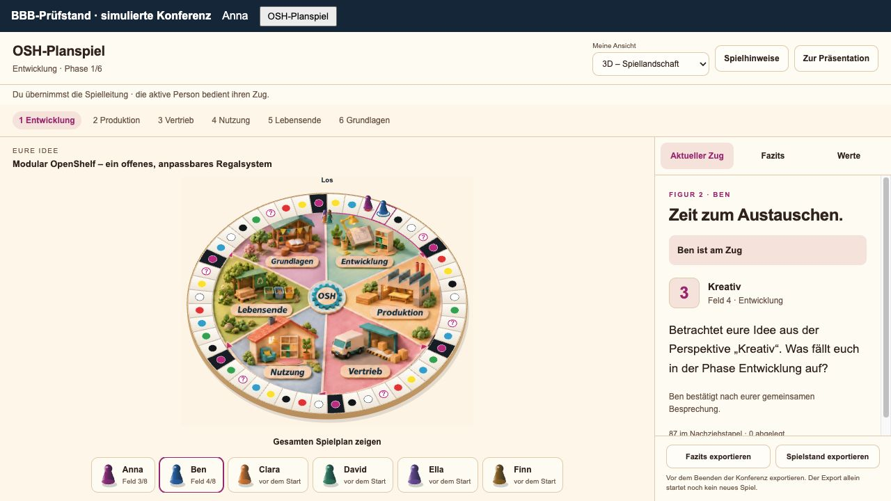

# OSH-Planspiel: persönliche 2D- und 3D-Ansichten

> Betriebsangaben sind anonymisierte Beispiele. [Platzhalter und Übertragung auf eine eigene Instanz](datenschutz-und-betriebsbeispiele.md) vor der Ausführung beachten.

Stand: **6. November 2026** · vorbereitetes Release **0.1.0-pilot.6** · SDK **1.0.0-beta.3** · Ereignisprotokoll **2**.

**Status:** Implementiert, lokal geprüft und als Installationspaket vorbereitet. Die Aktivierung auf bbb.example.org benötigt die interaktive sudo-Passworteingabe des Administrators. Eine Live-Abnahme von pilot.6 in BBB ist noch offen; der zuletzt bestätigte Betriebsstand ist pilot.5.

## Bedienung

Jede Person – auch ohne Präsentationsrecht und auch als Zuschauer – kann im Kopfbereich unter **Meine Ansicht** jederzeit selbst wählen:

| Flache Ansichten | Räumliche Ansichten |
| --- | --- |
| 2D – Klar | 3D – Tischmodell |
| 2D – Werkstatt | 3D – Werkstattmodell |
| 2D – Dialog | 3D – Spiellandschaft |

Die Auswahl gilt nur im eigenen Browser für die aktuelle BBB-Kennung. Sie wird lokal gespeichert und beim Wiederöffnen oder Neuladen übernommen. Eine andere Person im selben Browser hat eine eigene Auswahl. Bei einer neuen BBB-Kennung oder gelöschtem Browserspeicher beginnt die Auswahl mit „2D – Klar“. Wenn der Browser die Speicherung sperrt, funktioniert die Auswahl für die geöffnete App weiterhin.

**Hütchen werden ausschließlich in den drei 3D-Ansichten verwendet.** In 2D bleiben die bisherigen runden, nummerierten Spielfiguren bestehen. Auf den 3D-Spielfeldern stehen keine Feldnummern. Acht Felder pro Phase, die Reihenfolge der Perspektiven, Fragefelder und gemeinsame Abschlussfelder bleiben unverändert. Eine Person oder ein Team behält beim Ansichtswechsel Farbe und Spielposition.

Die räumlichen Ansichten zeigen eine feste Perspektive. Der Bildausschnitt kann weiterhin über „Gesamten Spielplan zeigen“ und „Rundkurs vergrößern“ gewechselt werden. Karten, Zugbedienung und Fazits befinden sich in der Seitenleiste und bleiben unabhängig von der gewählten Ansicht lesbar.



[Zweiter Teilnehmer: derselbe Spielstand in 2D – Dialog mit runden Figuren](../assets/osh-pilot6-2d-dialog.png). Beide Abbildungen stammen aus dem lokalen Prüfstand.

## Umsetzung

- `src/views.ts`: sechs gültige Ansichten, Gestaltung und Dimension sowie defensive lokale Speicherung je BBB-Kennung. Ansichtswechsel senden keine BBB-Aktion.
- `src/board.tsx`: flacher Spielplan oder räumliche Darstellung; Hütchen nur in 3D. In den PNGs wird nur die innere Illustration sichtbar gemacht. Deren gemalter Spielring, Würfel, Beispielkarten und dekorative Figuren sind nicht Teil des interaktiven Bretts.
- `src/board-geometry.ts`: Projektion, Ringsegmente und Figurenpositionen. Alle 48 Felder werden aus `content/board.de.json` in 7,5-Grad-Segmente gezeichnet; sechs Feldergruppen mit jeweils acht Feldern. Auch sechs gemeinsam wartende Hütchen erhalten unterscheidbare Positionen innerhalb ihres Abschlussfeldes.
- `src/app.tsx`: persönliche Auswahl für alle Rollen. Gemeinsamer Spielstand, Zugrechte und BBB-Präsentationsrolle bleiben unverändert.
- `designs/boards-3d/`: drei aus den freigegebenen Gestaltungsstudien übernommene PNG-Illustrationen ohne Feldnummern. Der Bildwechsel verwirft die vorige Textur, damit nicht kurzzeitig eine alte Illustration mit einer neuen Zuschneidung erscheint. Wenn eine Illustration nicht geladen werden kann, bleiben Ring, Phasennamen und Figuren sichtbar.

Die Darstellung kombiniert SVG-Geometrie mit räumlichen Illustrationen (2,5D). Sie benötigt keine zusätzliche Grafikbibliothek, kein WebGL und keinen zusätzlichen Spielserver. Freies Drehen der Kamera oder eine 3D-Physiksimulation sind nicht Bestandteil dieses Releases.

Das Release enthält **neun Dateien**: JavaScript, Manifest, Release-Metadaten, drei SVG-Spielpläne und drei PNG-Illustrationen. Build, lokaler Prüfstand, Paketierung und Installer kennen die zusätzlichen Dateien. Das Ereignisprotokoll bleibt Version 2.

## Prüfung

- Typprüfung, 27 TypeScript-Tests, Build und Paketierung erfolgreich.
- Vier Installertests und Ruby-Syntaxprüfung erfolgreich; Rückweg auf pilot.5 mit dessen unveränderten Prüfsummen vorbereitet.
- Alle sechs Ansichten im lokalen BBB-SDK-Prüfstand geöffnet. 3D zeichnet 48 Felder und sechs Hütchen; 2D zeichnet sechs runde Figuren und keine Hütchen.
- Zwei Teilnehmer desselben Browsers sehen unterschiedliche Ansichten desselben Spielstands. Nach Wechsel durch alle sechs Ansichten bleiben die zwei ursprünglichen Ereignisse „visibility“ und „start“ unverändert; kein Ansichtsereignis wurde versendet.
- Anna würfelt 3 und steht auf Feld 3. Nach ihrem Zug würfelt Ben ebenfalls 3; wegen des belegten Feldes steht Ben regelgemäß auf Feld 4. Beide Browser zeigen dieselben Positionen, einer in 3D und einer in 2D.
- Die persönliche Auswahl bleibt nach Neuladen sowie Schließen und Wiederöffnen der App bestehen. Die Gesamtansicht mit Legende wurde ebenfalls geprüft.

Dies sind lokale Prüfungen mit simuliertem BBB-Transport, keine native Live-Abnahme. In BBB nach Aktivierung mindestens zwei Personen mit unterschiedlichen Ansichten, einen eigenen Zug ohne Präsentationsrechte und gemeinsam wartende Figuren prüfen.

## Aktivierung auf Beispielraum A

Die Übertragung wurde abgeschlossen; Installer und Archiv stimmen auf dem Server mit `SHA256SUMS` überein. Das vorbereitete Paketverzeichnis ist `/srv/osh-planspiel-example/osh-planspiel-ansichten-20261106/`. Auf dem BBB-Server:

```sh
cd /srv/osh-planspiel-example/osh-planspiel-ansichten-20261106
sha256sum -c SHA256SUMS
sudo python3 -I install-pilot.py check
sudo python3 -I install-pilot.py install
```

Der Installer kontrolliert die Raumidentität, das SDK, alle neun Dateien und deren öffentliche HTTPS-Auslieferung, bevor er den Planspiel-Verweis im bestehenden Raum umstellt. Andere Plugins bleiben erhalten. Er startet keinen BBB-Dienst neu und beendet keine Konferenz.

Die neue Version gilt für die **nächste neu begonnene Konferenz** in Beispielraum A. Laufende Spiele erst abschließen beziehungsweise Fazits exportieren; ein bloßes Neuladen innerhalb eines alten Meetings ersetzt die dort festgelegte Plugin-Version nicht.

Rückweg zur bisher bestätigten Version pilot.5:

```sh
sudo python3 -I /srv/osh-planspiel-example/osh-planspiel-ansichten-20261106/install-pilot.py rollback
```

Das sudo-Passwort gehört ausschließlich in den lokalen Terminal-Prompt, nicht in Chat, Installer oder Dokumentationsrepository.
