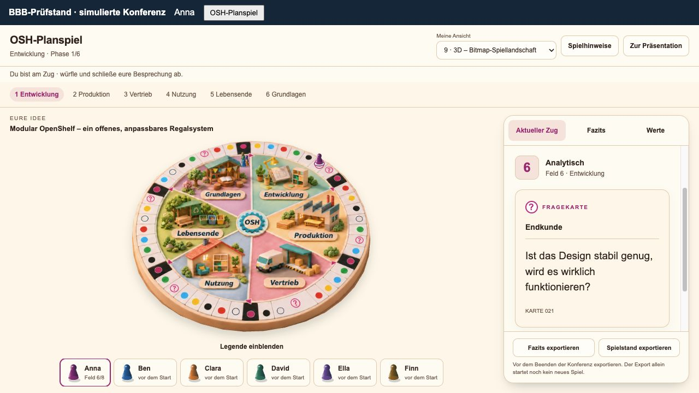

# Bitmap-Ansichten 7–9 und schwebende Seitenleiste

> Betriebsangaben sind anonymisierte Beispiele. [Platzhalter und Übertragung auf eine eigene Instanz](datenschutz-und-betriebsbeispiele.md) vor der Ausführung beachten.

Stand: **6. November 2026** · App **0.1.0-pilot.7** · lokal geprüft und als Update vorbereitet. Die Aktivierung dieser Version und eine native BBB-Abnahme sind noch offen. Die Dateien von pilot.6 sind inzwischen auf dem Server nachgewiesen; der letzte direkt beobachtete Spielstart bleibt pilot.5.

## Sichtbare Änderungen

Unter **Meine Ansicht** stehen neun nummerierte Varianten zur Verfügung. Jede Person wählt weiterhin unabhängig:

| Nr. | Ansicht | Spielbrett |
| --- | --- | --- |
| 1 | 2D – Klar | Flacher SVG-Spielplan |
| 2 | 2D – Werkstatt | Flacher SVG-Spielplan |
| 3 | 2D – Dialog | Flacher SVG-Spielplan |
| 4 | 3D – Tischmodell | Gezeichneter Ring mit innerer Illustration |
| 5 | 3D – Werkstattmodell | Gezeichneter Ring mit innerer Illustration |
| 6 | 3D – Spiellandschaft | Gezeichneter Ring mit innerer Illustration |
| 7 | 3D – Bitmap-Tischmodell | Vollständig illustrierter PNG-Spielplan |
| 8 | 3D – Bitmap-Werkstatt | Vollständig illustrierter PNG-Spielplan |
| 9 | 3D – Bitmap-Spiellandschaft | Vollständig illustrierter PNG-Spielplan |

Die Varianten 7–9 übernehmen auch den gemalten Rundkurs, die Kanten und die Oberfläche aus den freigegebenen Bildentwürfen v5. Die plastischen Details bleiben so erhalten. Dekorative Beispielfiguren, Würfel und Karten außerhalb des Bretts werden ausgeblendet. Die beweglichen Hütchen zeigen ausschließlich den wirklichen Spielstand. Keine Feldnummern; sechs Phasen mit je acht Feldern.

In allen 3D-Ansichten 4–9 steht der rechte Informationsbereich mit etwas Abstand zum Rand, abgerundeten Ecken, feiner Lichtkante und dezentem Schatten über dem Hintergrund. Karten, Fazits und Werte bleiben normal bedienbar. In 2D bleibt die bisherige flache Darstellung erhalten.

**Legende einblenden** zeigt bei den Bitmap-Ansichten Perspektivfarben, Fragekarte und Phasenabschluss. **Legende ausblenden** vergrößert wieder das Brett. Die Ansichten 1–6 behalten die bisherige Ausschnittumschaltung. Alle räumlichen Ansichten haben eine feste Perspektive.



*Lokaler BBB-Prüfstand mit fiktiven Teilnehmernamen; kein Live-BBB-Nachweis.*

Weitere Bildschirmansichten: [7 – Tischmodell](../assets/osh-pilot7-bitmap-tischmodell.png), [8 – Werkstatt](../assets/osh-pilot7-bitmap-werkstatt.png).

## Implementierung und Erweiterung

- `src/views.ts` ergänzt die bisherigen sechs IDs um `3d-bitmap-tischmodell`, `3d-bitmap-werkstatt` und `3d-bitmap-spiellandschaft`. Die gespeicherten bisherigen IDs bleiben gültig.
- `src/board.tsx` verwendet für die neuen Bretter ein HTML-Bild aus der unveränderten PNG-Datei. Die darüberliegende SVG-Ebene enthält lediglich Feldhinweise, die Markierung des erreichten Feldes und bewegliche Hütchen. Sie zeichnet keinen Ersatz-Rundkurs.
- `src/bitmap-geometry.ts` beschreibt je Bild Zuschnitt, Silhouette und 48 gemessene Markermittelpunkte in den ursprünglichen 1672 × 941 Pixeln. Figuren werden den gemalten Positionen zugeordnet. Gruppen warten mit leicht versetzten Hütchen am gemeinsamen Abschlussfeld. Änderungen am Bild erfordern eine erneute Zuordnung der Marker und Sichtprüfung.
- Die Bitmap-Felder sind durch die Illustration teilweise unterschiedlich breit. Es wird deshalb nicht die gleichwinklige Projektion der Ansichten 4–6 verwendet. Feldfolge und Spielregeln kommen weiterhin aus dem gemeinsamen Datenmodell.
- Bei einem Bildladefehler erscheint ein Hinweis mit dem bisherigen 3D-Modell als Ersatz. Auch dieses besitzt bereits eine lesbare Ersatzdarstellung ohne Illustration.
- Die Seitenleiste erhält ihren Schatten über die Klasse `osh-dimension-3d`. Die drei vorhandenen PNG-Dateien werden wiederverwendet: weiterhin neun Release-Dateien, keine zusätzliche Bibliothek und kein eigener Spielserver.

## Prüfung

28 Anwendungstests, TypeScript-Prüfung, Build, Paketierung, vier Installertests und Ruby-Syntaxprüfung erfolgreich. Die Tests prüfen alle neun Darstellungen, 48 Feldzuordnungen je Bitmap, die unveränderten logischen Positionen sowie getrennte Speicherung und das gemeinsame Warten der Hütchen.

Im lokalen Browserprüfstand:

- Alle neun Varianten gewählt: Hütchen nur in 3D, Kreise nur in 2D; 48 benannte Feldpositionen in jeder 3D-Ansicht.
- Schatten in allen Ansichten 4–9; keiner in 1–3.
- Alle drei Bitmap-Ansichten visuell geprüft und als Bildschirmabbildungen gesichert.
- Durch den Wechsel aller neun Varianten blieb das gemeinsame Ereignisprotokoll unverändert bei vier Ereignissen.
- Anna nutzte Ansicht 9, Ben Ansicht 8. Anna würfelte 6 und erreichte Feld 6; Ben würfelte ebenfalls 6 und gelangte wegen der Belegung auf Feld 7. Beide sahen identische Positionen.
- Bens Auswahl blieb nach Schließen/Wiederöffnen und nach Neuladen erhalten; Annas Auswahl wurde nicht verändert. Die Bildschirmlegende wurde ein- und ausgeblendet. Keine Warnungen oder Fehler in den Browserkonsolen.

## Aktivierung in Beispielraum A

Das geprüfte Paket liegt unter `/srv/osh-planspiel-example/osh-planspiel-bitmap-20261106/` auf dem bestehenden BBB-Server. Die übertragenen Dateien wurden mit `SHA256SUMS` geprüft. Zum Aktivieren **auf dem BBB-Server** ausführen:

```sh
sudo python3 -I /srv/osh-planspiel-example/osh-planspiel-bitmap-20261106/install-pilot.py install
```

Der Server verlangt das sudo-Passwort interaktiv; deshalb wurde die Aktivierung nicht durch den Agenten ausgeführt. Der Installer prüft Raumidentität, SDK und öffentliche Dateien, erhält andere Plugins und stellt Beispielraum A auf die neue Manifestadresse um. Es werden weder Dienste noch eine laufende Konferenz neu gestartet. Die neue Version wird erst beim nächsten Neubeginn der Konferenz geladen. Vorher Ergebnisse eines laufenden Spiels exportieren.

Optionaler reiner Vorabtest sowie Rückweg:

```sh
sudo python3 -I /srv/osh-planspiel-example/osh-planspiel-bitmap-20261106/install-pilot.py check
sudo python3 -I /srv/osh-planspiel-example/osh-planspiel-bitmap-20261106/install-pilot.py rollback
```

`check` aktiviert nichts. `rollback` ist eine Alternative nach einer Installation und stellt die vorherige Version **pilot.6** wieder her. Deren neun Dateien wurden auf dem Server mit den Prüfsummen des unveränderten archivierten Releases verglichen. Es ist kein Wiederherstellen eines Spielstands.

Nach Aktivierung eine neue Beispielraum A starten und mit zwei Personen die persönliche Auswahl 1–9, eigene Würfe, Bilddarstellung und Seitenleiste prüfen. Diese native Abnahme ist noch ausstehend.

[Implementierungs-How-to](osh-planspiel-implementierung-howto.md) · [Bedienung](osh-planspiel-bedienungsanleitung-online.md) · [Changelog](../CHANGELOG.md)
