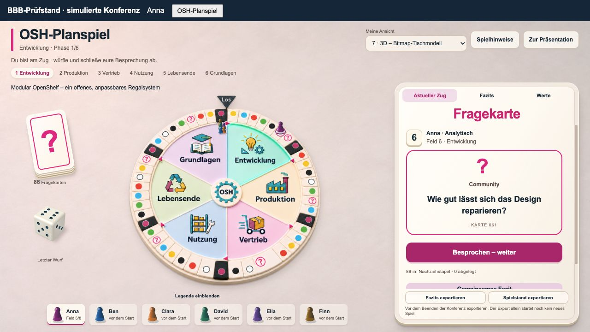
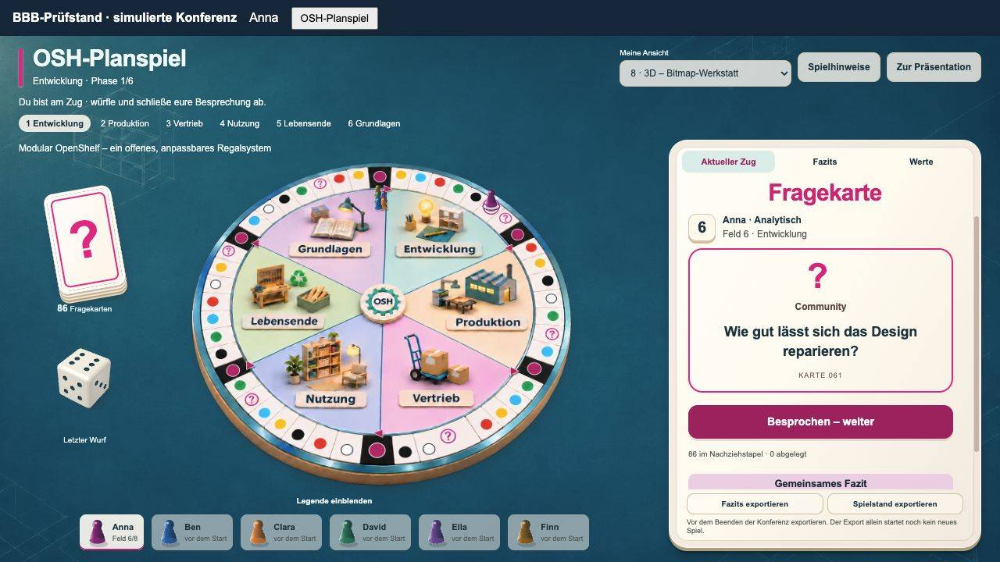
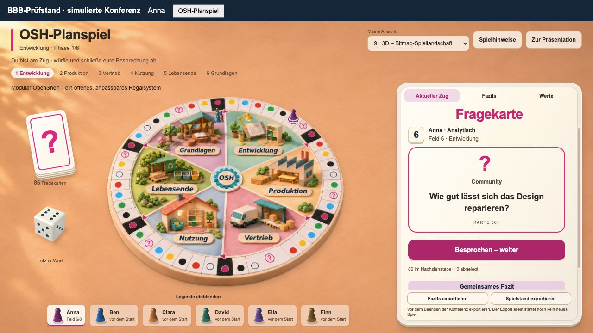

# Grafikupdate: Brettkonturen, Würfel und sechs Ansichten

> Betriebsangaben sind anonymisierte Beispiele. [Platzhalter und Übertragung auf eine eigene Instanz](datenschutz-und-betriebsbeispiele.md) vor der Ausführung beachten.

Stand: **6. November 2026** · **0.1.0-pilot.9** · lokal geprüft und auf dem BBB-Server bereitgestellt; noch nicht aktiviert. Letzte native Live-Abnahme: pilot.5.

## Änderungen

Die drei Bitmap-Spielpläne **7–9** bleiben erhalten. Ihre Körperkonturen wurden an den Originalbildern neu vermessen und durch glatte Kurven ersetzt. Die Maske entfernt das Umfeld, erhält aber die volle sichtbare Brettdicke. Eine feine Alpha-Kante und ein enger Kontaktschatten vermeiden den bisherigen groben Ausschnitt. Die drei PNGs und alle 48 Markerkoordinaten sind unverändert.

Der Würfel besitzt nun gleich lange Raumkanten, gerundete Ecken, Materiallicht und einen Bodenschatten. Alle drei sichtbaren Flächen tragen perspektivisch projizierte Augen. Die Oberseite zeigt ausschließlich den bestätigten Wurf; Gegenflächen ergeben sieben. Vor dem ersten Wurf steht ein korrekt orientiertes Fragezeichen. Das ist die ruhende Ergebnisanzeige; eine Wurfanimation ist weiterhin nicht integriert.

Die alten projizierten Ansichten **4–6 sind entfernt**. Die Auswahl enthält **1, 2, 3, 7, 8, 9**. Gespeicherte alte 3D-Auswahl wird automatisch auf die passende Bitmap-Variante umgestellt. Hütchen bleiben den drei Bitmap-Ansichten vorbehalten; 2D behält Kreise. Der rechte Kartenbereich bleibt erhöht und weich beschattet.

## Browserbelege

Die Bilder stammen aus dem lokalen BBB-SDK-Prüfstand mit fiktiven Teilnehmern, nicht aus einer Live-Konferenz.

### 7 · Bitmap-Tischmodell



### 8 · Bitmap-Werkstatt



### 9 · Bitmap-Spiellandschaft



## Prüfung

- 31 TypeScript-Tests, Typprüfung und Build/Paket bestanden; vier Installertests und Ruby-Syntax erfolgreich.
- Drei getrennte Arbeitsaufgaben: Brettkonturen, Würfelgeometrie und unabhängige Grafikabnahme. Alle drei Konturen und alle sechs Würfelergebnisse geprüft, einschließlich Neutralzustand. Keine sichtbaren Schnittfacetten oder abgeschnittenen Körperkanten in den geprüften Browseransichten.
- Zwei Teilnehmer mit den Ansichten 7 und 8 zeigten identische Positionen (Anna Feld 6, Ben Feld 7), bestätigten Würfelwert 6 und dieselbe Kartenanzahl. Obere und seitliche Augen entsprachen den Flächenwerten.
- Ansichtswechsel ließen die vier vorhandenen Spielereignisse unverändert. Wiederöffnen stellte die persönliche Auswahl wieder her. Genau sechs Optionen vorhanden; entfernte IDs in den Tests auf Bitmap-Varianten umgestellt.
- 620 Pixel breiter Inhaltsbereich ohne horizontalen Überlauf geprüft; Requisiten ausgeblendet, Kartenbereich unter dem Brett. Browserkonsolen ohne Warnungen oder Fehler.
- Native BBB-Abnahme der neuen Version steht aus. Die Prüfung ersetzt keinen vollständigen Team- und Phasentest.

## Aktivierung in Beispielraum A

Die Dateien liegen auf dem Server unter `/srv/osh-planspiel-example/osh-planspiel-grafik-20261106/`. Die übertragenen Prüfsummen wurden bestätigt. Der vorhandene Installer benötigt interaktives sudo; in dieser Arbeit wurde keine Konferenz beendet oder neu gestartet.

Auf dem BBB-Server ausführen:

```sh
cd /srv/osh-planspiel-example/osh-planspiel-grafik-20261106
sha256sum -c SHA256SUMS
sudo python3 -I install-pilot.py install
```

Der Installer prüft Zielraum und Paket, installiert zwölf statische Dateien, verifiziert HTTPS und setzt den Raumverweis für künftige Konferenzen. Laufende Konferenzen behalten ihre beim Start geladene Version. Erst eine anschließend neu gestartete Konferenz kann pilot.9 laden.

Der geprüfte Rückweg führt ausdrücklich zu **pilot.7**. pilot.8 war bereitgestellt, aber noch nicht installiert; deshalb ist es kein Rückwegziel:

```sh
sudo python3 -I /srv/osh-planspiel-example/osh-planspiel-grafik-20261106/install-pilot.py rollback
```

[Bedienung](osh-planspiel-bedienungsanleitung-online.md) · [How-to](osh-planspiel-implementierung-howto.md) · [Prüfsummen](quellstand-und-pruefungen.md)
