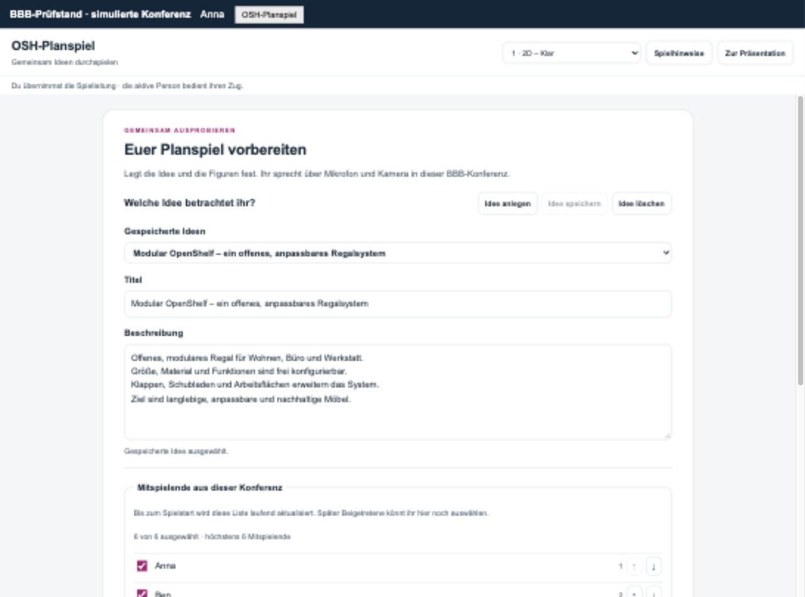

# Update: Ideen je Konferenzraum verwalten

> Betriebsangaben sind anonymisierte Beispiele. [Platzhalter und Übertragung auf eine eigene Instanz](datenschutz-und-betriebsbeispiele.md) vor der Ausführung beachten.

Stand: **7. November 2026** · **0.1.0-pilot.11** · lokal geprüft, Aktivierung auf BBB und native Live-Abnahme noch offen.

## Einstieg und Bedienung

Neben „Welche Idee betrachtet ihr?“ stehen **Idee anlegen**, **Idee speichern** und **Idee löschen**. Darunter folgen die Auswahl aller gespeicherten Ideentitel, ein einzeiliges Feld **Titel** und das mehrzeilige Feld **Beschreibung**. Bei wenig Platz stehen die Buttons in einer eigenen Zeile. Nur der aktuelle BBB-Präsentator erhält diese Verwaltung.

**Idee anlegen** öffnet einen leeren Entwurf. **Idee speichern** legt ihn dauerhaft ab beziehungsweise aktualisiert die ausgewählte Idee. **Idee löschen** verlangt eine Bestätigung. Beim Wechsel mit ungespeicherten Änderungen kann die Spielleitung weiterbearbeiten oder den Entwurf verwerfen. Eine Import- oder Exportfunktion für den Ideenbestand gibt es nicht.

Neue Räume erhalten einmalig das Beispiel **Modular OpenShelf – ein offenes, anpassbares Regalsystem**. Die Beschreibung wurde aus dem Präsentationsbeispiel abgeleitet und umfasst vier Textzeilen:

> Offenes, modulares Regal für Wohnen, Büro und Werkstatt.  
> Größe, Material und Funktionen sind frei konfigurierbar.  
> Klappen, Schubladen und Arbeitsflächen erweitern das System.  
> Ziel sind langlebige, anpassbare und nachhaltige Möbel.

Die Beschreibung lässt die Entwicklung durch eine Community offen, damit dieser Aspekt im Spiel entstehen kann. Die ursprüngliche Materialauswertung bleibt als Quellenbeleg erhalten.

Die Beschreibungseingabe zeigt sechs Zeilen und erlaubt bis zu 4.000 Zeichen. Die Vorgabe von höchstens sechs Zeilen betrifft den vorausgefüllten Beispieltext. Der Titel erlaubt 500 Zeichen. Beim Spielstart werden Titel und Beschreibung als Kopie in den gemeinsamen Spielstand übernommen. Eine spätere Änderung der gespeicherten Vorlage verändert keine laufende Partie. Im Spiel lässt sich die Beschreibung aufklappen; sie erscheint auch im bestehenden Fazit- und Spielstandexport.



Über der Ansichtsauswahl steht keine zusätzliche sichtbare Überschrift mehr. Für Screenreader bleibt „Meine Ansicht“ als zugänglicher Name erhalten.

## Dauerhafte, portierbare Datei

Der Nutzer hat **getrennte Ideenbestände je Konferenzraum** gewählt. Die Bestände liegen gemeinsam in einer UTF-8-JSON-Datei auf dem bestehenden BBB-Server:

```text
<IDEAS_DATA_DIR>/ideas.json
```

Die Datei enthält `schemaVersion: 1` und unter `rooms` einen Eintrag je stabilem Raumschlüssel. Jeder Eintrag besitzt eine Revision und eine Liste mit `id`, `title`, `description` sowie bei Änderungen `updatedAt`. Keine Benutzerkennungen, Sitzungstoken oder Cookies werden gespeichert. Bereits initialisierte, später leer gelöschte Räume bleiben leer; das Beispiel wird nicht bei jedem Öffnen erneut eingefügt.

Die Datei wird außerhalb der versionierten Plugin-Verzeichnisse gespeichert und bleibt bei Updates, Konferenzende und Dienstneustart erhalten. Eine exklusive Dateisperre und atomarer Dateiaustausch verhindern konkurrierende Teil-Schreibvorgänge. Veraltete Revisionen liefern einen Konflikt; beschädigte Dateien werden nicht durch einen neuen leeren Bestand ersetzt. Begrenzungen: 1.000 Ideen je Raum und höchstens 16 MiB für die Gesamtdatei.

Für einen administrativen Serverumzug den Dienst kurz anhalten, die JSON-Datei sichern/kopieren, auf dem Ziel die konfigurierten Raumschlüssel beibehalten oder bewusst zuordnen und den Dateieigentümer `osh-planspiel:osh-planspiel` sowie Modus `0600` setzen. Danach den Dienst starten. Die Laufzeitkonfiguration wird separat an die Zielinstanz angepasst; ein kompletter Maschinenumzug ist für die Übernahme der Ideen nicht erforderlich.

## Betrieb auf dem vorhandenen BBB-Server

Spielzüge bleiben in den nativen BBB-Datenkanälen. Für die dauerhafte Datei ergänzt pilot.11 den kleinen Python-Standardbibliotheksdienst **`osh-planspiel-ideas.service`** auf `127.0.0.1:<IDEAS_PORT>`. Es wird kein zusätzlicher Rechner und keine Datenbank benötigt. Die bisherige Aussage „nur statische Dateien, kein zusätzlicher Dienst“ gilt ab dieser Version nicht mehr für die Ideenverwaltung.

Nginx vermittelt den gleichnamigen App-Endpunkt `/_bbb4/osh-planspiel/ideas`. Jede Anfrage enthält das BBB-Sitzungstoken und die bestehenden Sitzungscookies. Der Dienst prüft Ursprung, aktuelle Teilnahme und Präsentatorrecht über BBB sowie die erlaubte Raumzuordnung. Die Identität wird aus der BBB-Antwort abgeleitet; der Browser bestimmt den Raumschlüssel nicht. Der [offizielle BBB-ConnectionController](https://github.com/bigbluebutton/bigbluebutton/blob/develop/bigbluebutton-web/grails-app/controllers/org/bigbluebutton/web/controllers/ConnectionController.groovy) beschreibt den verwendeten Authentifizierungsendpunkt und die Präsentator-/Raumheader. Die lokale Implementierung berücksichtigt auch die Online-Angabe im JSON-Antwortkörper.

Konfiguration: `<IDEAS_CONFIG_FILE>`. Dort stehen Ursprung, lokaler BBB-Authentifizierungsendpunkt, Datendatei und die Abbildung der externen BBB-Meetingkennung auf den stabilen Raumschlüssel. Die Meetingkennung eines laufenden Konferenztermins ist kein geeigneter Speicherschlüssel. Im Referenzpilot wird die bestehende b3scale-/Greenlight-Zuordnung verwendet und bei der Installation gegen die vorhandene Notes-Konfiguration geprüft. Ein BBB-API-Geheimnis wird nicht benötigt.

Die generische Speicherkomponente kann mit entsprechender Konfiguration auch andere BBB-Räume bedienen. Der mitgelieferte Installer bleibt bewusst an Beispielraum A gebunden. Andere Betreiber müssen zusätzlich zum statischen Plugin den lokalen Speicherdienst, die Nginx-Route und ihre eigene geprüfte Raumzuordnung einrichten.

## Installation und Rückweg

Das geprüfte Paket liegt auf dem Server unter `/srv/osh-planspiel-example/osh-planspiel-ideen-20261107/`; alle drei Prüfsummen wurden bestätigt. Die Aktivierung scheiterte ausschließlich an der erforderlichen interaktiven sudo-Passworteingabe. Auf dem BBB-Server ausführen:

```sh
cd /srv/osh-planspiel-example/osh-planspiel-ideen-20261107
sha256sum -c SHA256SUMS
sudo python3 -I install-pilot.py check
sudo python3 -I install-pilot.py install
```

Der Hauptinstaller enthält den Speicherinstaller. `check` kontrolliert Paket, SDK, Raumweitergabe, freie Portbelegung, Dateipfade und vorhandene Raumzuordnung. `install` ergänzt den unprivilegierten Dienst, prüft dessen Erreichbarkeit, lädt Nginx neu und aktiviert das neue Plugin für künftige Konferenzen. BBB und Greenlight werden nicht neu gestartet; eine laufende Konferenz wird nicht beendet. Das separate `install-ideas.py` wird ebenfalls zur Nachvollziehbarkeit mitgeliefert.

Rückweg auf die anhand aller zwölf Dateien erneut geprüfte pilot.9:

```sh
sudo python3 -I /srv/osh-planspiel-example/osh-planspiel-ideen-20261107/install-pilot.py rollback
```

Die Ideendatei bleibt beim Rückweg erhalten. Auch `disable` entfernt nur die verwaltete Plugin-Aktivierung; es löscht weder Daten noch den Speicherdienst. Wenn dieser vorübergehend nicht benötigt wird, kann der Betreiber ihn mit `sudo systemctl stop osh-planspiel-ideas.service` anhalten. Vor erneutem Einsatz wieder starten.

## Prüfstand

- 36 TypeScript-Tests, Typprüfung, Build/Paket und Ruby-Syntax erfolgreich.
- Sechs Installertests einschließlich eingebetteter Speicherdateien, Manipulationsprüfung und verhinderter Raumaktivierung bei Speicherfehler.
- Sechs Speicher-/HTTP-Tests: Anlegen, Bearbeiten, Löschen, Neustart, Dateikopie, getrennte Räume, Konflikte, Schreibabbruch, beschädigte Datei und ungültige Eingaben.
- Lokale HTTP-Prüfung mit simuliertem BBB: Präsentator, Teilnehmer ohne Recht, ungültige Sitzung, falsches Cookie, fremder Ursprung und entzogene Präsentatorrolle.
- Browser: Auswahl, neuer Entwurf, Speichern, Wiederladen, Bearbeiten, Löschdialog/Abbruch, ungespeicherte Änderungen, getrennte Räume und Warteansicht. Spielstart überträgt die Beschreibung an einen zweiten Teilnehmer. Ein 620-Pixel-Inhaltsbereich wurde geprüft.
- Installation im echten systemd-/Nginx-Verbund und native BBB-Abnahme stehen noch aus. Die lokale Simulation ist kein Live-Nachweis.

[Bedienungsanleitung](osh-planspiel-bedienungsanleitung-online.md) · [Implementierungs-How-to](osh-planspiel-implementierung-howto.md) · [Changelog](../CHANGELOG.md)
