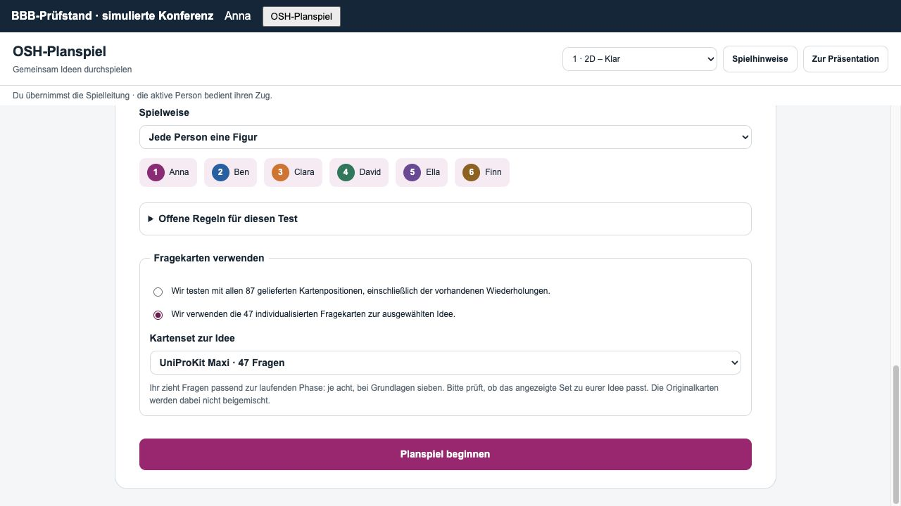

# Individuelle Kartensets für UniProKit Maxi und Modular OpenShelf

> Betriebsangaben sind anonymisierte Beispiele. [Platzhalter und Übertragung auf eine eigene Instanz](datenschutz-und-betriebsbeispiele.md) vor der Ausführung beachten.

Stand: **7. November 2026** · App **0.1.0-pilot.12** · lokal geprüft, Aktivierung und native BBB-Abnahme noch offen.

## Inhalt

Beide Ideen erhalten **47 unterschiedliche Fragen**. Die zwölf zuvor im Chat vorgestellten Fragen je Idee bleiben erhalten; jeweils 35 kommen hinzu. Die Rollen sind Blickwinkel der Fragen, keine festen Spielerrollen. Es handelt sich um neu formulierte, individuelle Karten; der originale Datensatz bleibt unverändert bei 87 Kartenpositionen mit 47 unterschiedlichen Fragetexten.

- [Alle 47 Fragen für UniProKit Maxi](karten/uniprokit-maxi-v1.de.md): Nutzerbeschreibung als Grundlage – UniProKit von Open Source Ecology Germany im Maßstab 2:1, etwa für große Fräsen und 3D-Drucker.
- [Alle 47 Fragen für Modular OpenShelf](karten/modular-openshelf-v1.de.md): modulares Regal für Wohnen, Büro und Werkstatt mit anpassbaren Materialien, Abmessungen und Erweiterungen.

| Phase | Fragen je individuellem Set |
| --- | --- |
| Entwicklung | 8 |
| Produktion | 8 |
| Verteilung | 8 |
| Nutzung | 8 |
| Lebensende | 8 |
| Grundlagen | 7 |
| Gesamt | 47 |

Die Phasenzuordnung ist redaktionell ergänzt. Der Nutzer hat ausdrücklich bestätigt, dass diese Karten **passend zur laufenden Phase** gezogen werden sollen. Die Fragen lassen mögliche Lösungen und eine spätere Community-Entwicklung offen. Es werden keine Antworten oder Punktebewertungen vorgegeben.

## Auswahl und Spielablauf

Nur die Spielleitung sieht vor dem Start den Bereich **Fragekarten verwenden**. Die bisherige Auswahl mit dem vollständigen Wortlaut „Wir testen mit allen 87 gelieferten Kartenpositionen, einschließlich der vorhandenen Wiederholungen.“ bleibt an erster Stelle. Direkt darunter steht **„Wir verwenden die 47 individualisierten Fragekarten zur ausgewählten Idee.“**

Die beiden Optionen schließen sich gegenseitig aus. Zunächst ist keine gewählt; der Start wird erst nach einer gültigen Auswahl freigegeben. Für individuelle Karten erscheint **Kartenset zur Idee**. Bekannte Titel schlagen das passende Set vor; die Spielleitung kann die Zuordnung ausdrücklich auswählen. Bei unbekanntem Titel bleibt die Auswahl leer, bis ein Set gewählt wird. Ein Wechsel der Idee beziehungsweise ihres Titels verwirft eine vorherige manuelle Zuordnung und ermittelt die Vorauswahl neu. Das System erzeugt keine Karten für beliebige neue Ideen.



Beim Start wird die Set-Kennung in den gemeinsamen Spielstand kopiert. Alle Personen verwenden denselben deterministisch gemischten Stapel. Originalkarten werden nicht beigemischt. Reguläre Fragefelder und die freiwillige Zusatzfrage ziehen ausschließlich noch ungezogene Karten der aktuellen Phase. Jede Karte kommt höchstens einmal vor. Ist der Phasenvorrat leer, geht die Diskussion ohne weitere Karte weiter; es wird weder neu gemischt noch aus einer anderen Phase gezogen. Ein Fazit und der normale Phasenwechsel bleiben möglich.

Nicht gezogene Karten vergangener Phasen bleiben im Gesamtbestand dokumentiert, werden in späteren Phasen aber nicht nachgezogen. Deshalb zeigt die App sowohl die Zahl für die aktuelle Phase als auch den gesamten Nachziehstapel. Eine normale Partie muss nicht alle 47 Fragen verbrauchen. Der Originalstapel bleibt phasenübergreifend.

Kartenset, Rollen und Phasenzuordnung werden beim erneuten Laden beziehungsweise späteren Beitritt aus derselben Konferenzhistorie wiederhergestellt. Die Karten zeigen Nummer und Phase; der Ergebnistext nennt Set und Kartenanzahl. Die Auswahl ist nach Spielstart festgelegt.

## Implementierung

- `content/personalized/*.de.json`: zwei versionierte, statisch ausgelieferte Kartensets mit stabilen IDs, Rollen und `phaseIds`.
- `src/card-sets.ts`: Set-Verzeichnis, gemeinsame Kartenauflösung, Titelvorschläge und Phasenprüfung.
- `src/model.ts`: optionales `setup.cardSetId`, deterministisches Mischen des gewählten Sets, Ziehen ohne Zurücklegen innerhalb der Phase, Export.
- `src/app.tsx`: zwei Auswahloptionen, Set-Auswahl, Startprüfung, Phasenanzeige und Leerstandshinweis.
- Neue Ereignisse verwenden **Protokoll 3**. Originalspiele mit Protokoll 2 bleiben lesbar; eine fehlende Set-Kennung bedeutet den historischen Originalstapel. Individuelle Spielstarts im alten Format werden abgewiesen. Nicht unterstützte Leitungshistorien sperren Aktionen.

Die IDs `modular-openshelf-v1` und `uniprokit-maxi-v1` bezeichnen feste Inhalte. Bei späteren inhaltlichen Änderungen neue Set-Versionen anlegen und alte Sets für die Wiederherstellung laufender Historien beibehalten. Die Karten werden in das Plugin gebündelt; es gibt keinen Laufzeit-KI-Aufruf und keine neue Serverkomponente. Die Ideenverwaltung aus pilot.11 samt Datendatei bleibt bestehen. Das gespeicherte Ideenformat wird nicht geändert; die Kartensetauswahl gehört zur Partie.

## Prüfung

- **42 TypeScript-Tests** erfolgreich: darunter Vollständigkeit und eindeutige Karten, elf Rollen je Set, Verteilung 8/8/8/8/8/7, unveränderter Originalstapel, Titelvorschläge, vollständige Spiele mit beiden Sets, leerer Phasenvorrat und Wiederherstellung aus Protokoll 3.
- Typprüfung, Build/Paket, sechs Installertests und Ruby-Syntax erfolgreich.
- Browser: beide Set-Vorauswahlen, gegenseitiger Ausschluss, Startschutz bei unbekannter Zuordnung, Start mit 47 beziehungsweise 87 Karten, passende Frage, später Beitritt, Neuladen und Warteansicht ohne Leitungsoptionen geprüft.
- Darstellung der neuen Auswahl auch bei 620 Pixel Breite geprüft.
- Kein zusätzlicher vollständiger Live-Durchlauf in BBB; Serveraktivierung verlangt das sudo-Passwort.

## Aktivierung

Das Paket liegt auf dem BBB-Server unter `/srv/osh-planspiel-example/osh-planspiel-kartensets-20261107/`. Alle drei SHA-256-Prüfsummen wurden nach der Übertragung bestätigt. Die automatische Aktivierung wurde von der erforderlichen sudo-Passworteingabe gestoppt. Auf dem Server ausführen:

```sh
cd /srv/osh-planspiel-example/osh-planspiel-kartensets-20261107
sha256sum -c SHA256SUMS
sudo python3 -I install-pilot.py check
sudo python3 -I install-pilot.py install
```

Der Installer ist an Beispielraum A gebunden und aktiviert die Fassung für **eine anschließend neu gestartete Konferenz**. Er beendet keine laufende Konferenz und startet BBB/Greenlight nicht neu. Für die Abnahme müssen alle Personen die neue Plugin-Fassung laden. Ideenbestände bleiben erhalten.

Der mitgelieferte Rückweg bleibt die zuvor anhand ihrer zwölf Dateien überprüfte pilot.9:

```sh
sudo python3 -I /srv/osh-planspiel-example/osh-planspiel-kartensets-20261107/install-pilot.py rollback
```

[Bedienung](osh-planspiel-bedienungsanleitung-online.md) · [How-to](osh-planspiel-implementierung-howto.md) · [Changelog](../CHANGELOG.md)
