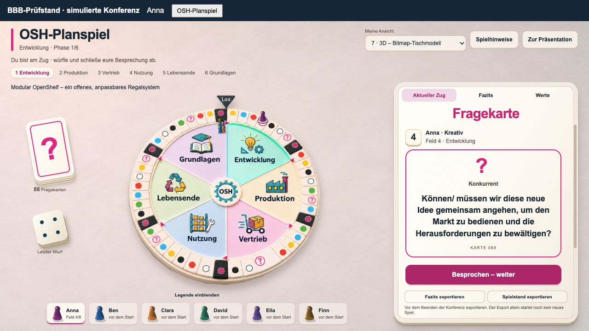

# Ansichten 7–9: Tischszene statt isoliertem Brett

> Betriebsangaben sind anonymisierte Beispiele. [Platzhalter und Übertragung auf eine eigene Instanz](datenschutz-und-betriebsbeispiele.md) vor der Ausführung beachten.

Stand: **6. November 2026** · App **0.1.0-pilot.8** · lokal geprüft, zur Aktivierung vorbereitet. Native Live-Abnahme dieser Version noch offen.

## Was sich ändert

Die **bestehenden Ansichten 7–9 werden ersetzt**, ohne zusätzliche Optionen anzulegen. Nummern, IDs und persönliche gespeicherte Auswahl bleiben erhalten. Die Ansichten **1–6 bleiben unverändert**.

Die Rückmeldung bezog sich auf das gesamte Umfeld des Bretts. Die Überarbeitung übernimmt deshalb die Wirkung der Originalentwürfe als zusammenhängende Tischszene:

- **7 – Bitmap-Tischmodell:** helle, leicht rosige Tischoberfläche, elfenbeinfarbener Kartenbereich und pinke Akzente.
- **8 – Bitmap-Werkstatt:** petrolfarbene Arbeitsfläche mit zurückhaltenden Konstruktionszeichnungen; helle Papierkarte darauf.
- **9 – Bitmap-Spiellandschaft:** warme, sandfarbene Tischfläche mit weichem Licht und dazu passender Papierkarte.

Der Kartenbereich hat eine feine innere Umrandung, eine sichtbare Papierkante und einen Bodenschatten. Fragen stehen in einem pinken Rahmen mit Fragezeichen und bleiben auswählbarer Text. Kopfzeile, Phasenanzeige und Figurenleiste gehören optisch zur Tischfläche. Bei ausreichender Breite stehen links ein Kartenstapel und ein ruhender Würfel. Das Brett sitzt großzügiger zwischen diesen Requisiten und der Karte.

**Die Brettgrafiken einschließlich des Rundkurses und der 48 Markerpositionen wurden nicht verändert oder neu generiert.** Die Bildkoordinaten für die Hütchen bleiben gleich. Spielregeln, acht Felder je Phase, persönliche Zugrechte und BBB-Synchronisierung bleiben unverändert.



[Ansicht 8 – Werkstatt](../assets/osh-pilot8-werkstatt.png) · [Ansicht 9 – Spiellandschaft](../assets/osh-pilot8-spiellandschaft.png)

*Die Abbildungen stammen aus dem lokalen BBB-Prüfstand mit fiktiven Namen, nicht aus einer nativen BBB-Abnahme.*

## Bedienung

Der Kartenstapel zeigt die echte Anzahl verbleibender Fragekarten. Der Würfel zeigt den letzten bestätigten Wurf; vor dem ersten Wurf steht ein Fragezeichen. Beides dient der Anzeige. **Würfeln**, **Zusätzliche Frage ziehen** und **Besprochen – weiter** bleiben im rechten Bereich mit denselben Berechtigungen bedienbar. Das ist noch keine Würfelwurfanimation.

**Gemeinsames Fazit** öffnet die bestehende Fazitübersicht. Dieser Verweis scrollt zusammen mit dem Karteninhalt, sodass er längere Fragen nicht verdeckt. Das Schreiben und Speichern eines Fazits erfolgt wie bisher am Phasenende durch die Spielleitung.

Lange Karten und zusätzliche Hinweise können rechts gescrollt werden; die Exportknöpfe bleiben erreichbar. Bei schmalem App-Bereich werden die dekorativen Requisiten ausgeblendet, bei noch kleinerer Breite wandert die Karte unter das Brett. Würfelwert, Stapelstand und Zugaktionen bleiben im rechten beziehungsweise unteren Informationsbereich vorhanden. Die Größenregeln beziehen sich auf die App-Breite, auch wenn BBB daneben andere Bereiche zeigt.

## Umsetzung

- `src/app.tsx`: Die Klasse `osh-bitmap-scene` und das passende Hintergrundbild werden ausschließlich für die drei bestehenden Bitmap-IDs gesetzt. Zusätzlich erhält der Kartenbereich einen Szenentitel und den Verweis auf die Fazitübersicht.
- `src/styles.css`: durchgehender Tischhintergrund, Papier- und Kartenflächen, Schatten, Kopfzeile, Figurenleiste und Container-Regeln. Die neuen Gestaltungsregeln sind auf die Bitmap-Ansichten begrenzt.
- `src/table-accessories.tsx`: rein darstellender Kartenstapel und Würfel aus `remaining.length` und `game.die`. Keine Zufallsziehung und keine zusätzlichen Spielereignisse.
- `designs/table-surfaces-v1/`: drei mit Imagegen aus den jeweiligen Bildvorlagen abgeleitete leere Tischflächen; Referenzen und Prompts stehen in `prompts.json`. Keine echte Spielerinformation wurde dafür verwendet.
- Build, Prüfstand und Installer liefern die drei zusätzlichen `boards/table-*.png` aus. **Zwölf statische Release-Dateien**; weiterhin kein zusätzlicher Dienst, keine neue Laufzeitbibliothek und keine KI-Funktion im Spiel.
- `board.tsx` und `bitmap-geometry.ts` bleiben gegenüber pilot.7 unverändert. Die Darstellung der 48 Felder bleibt damit dieselbe.

## Prüfung und Grenzen

28 Anwendungstests, Typprüfung, Build, Paketierung, vier Installertests und Ruby-Syntaxprüfung erfolgreich. Die neun Auswahloptionen bleiben bestehen. Die drei neuen Tischszenen wurden im Browser mit einer längeren Frage visuell geprüft; flache und bisherige projizierte Ansichten wurden zum Vergleich geöffnet.

Im Zweipersonentest nutzte Anna Ansicht 7 und Ben Ansicht 8. Anna würfelte 4, zog eine Frage und beendete ihren Zug; Ben würfelte anschließend 2. Beide Clients zeigten Anna auf Feld 4, Ben auf Feld 2, den Würfel mit zwei Augen und 86 verbleibende Fragekarten. Während der reinen Ansichtswechsel blieb das gemeinsame Protokoll unverändert bei vier Ereignissen. Der Fazitverweis wurde geprüft; Browserkonsolen ohne Warnungen oder Fehler.

Die Abnahme in einer echten BBB-Konferenz einschließlich kleiner App-Bereiche ist noch ausstehend. Die Screenshots belegen die normale Desktop-Darstellung des lokalen Prüfstands. Eine vorhandene kleine Bildschirm-PDF der Anleitung ist weiterhin der ältere Bedienstand; aktuell sind die Markdown-Dokumente.

## Aktivieren und zurückwechseln

Das Paket liegt auf dem bestehenden BBB-Server unter `/srv/osh-planspiel-example/osh-planspiel-tischszenen-20261106/`. Die übertragenen Dateien wurden mit `SHA256SUMS` erfolgreich geprüft. **Auf dem BBB-Server** aktivieren:

```sh
sudo python3 -I /srv/osh-planspiel-example/osh-planspiel-tischszenen-20261106/install-pilot.py install
```

Der Server verlangt eine interaktive sudo-Passworteingabe. Deshalb ist pilot.8 vorbereitet, aber durch den Agenten noch nicht aktiviert. Die neue Fassung wird beim nächsten Neubeginn von Beispielraum A geladen; der Installer startet weder BBB-Dienste noch eine laufende Konferenz neu. Ergebnisse laufender Spiele vorher exportieren.

Optionaler Vorabtest:

```sh
sudo python3 -I /srv/osh-planspiel-example/osh-planspiel-tischszenen-20261106/install-pilot.py check
```

Rückweg nach einer Installation:

```sh
sudo python3 -I /srv/osh-planspiel-example/osh-planspiel-tischszenen-20261106/install-pilot.py rollback
```

Der Rückweg führt auf **pilot.7** mit den bisherigen Bitmap-Ansichten. Dessen neun vorhandene Dateien wurden auf dem Server gegen die Prüfsummen des archivierten Releases geprüft. Der Rückweg stellt keinen Spielstand wieder her.

[How-to](osh-planspiel-implementierung-howto.md) · [Bedienung](osh-planspiel-bedienungsanleitung-online.md) · [Changelog](../CHANGELOG.md)
