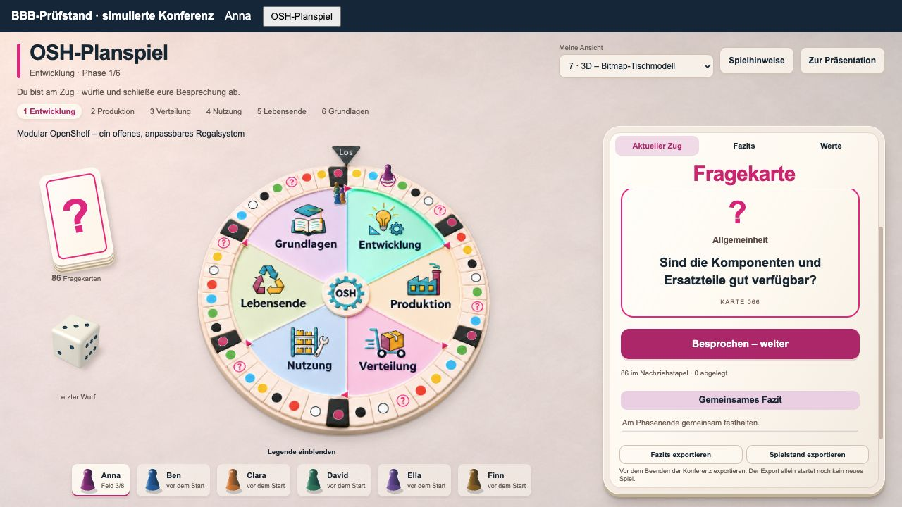
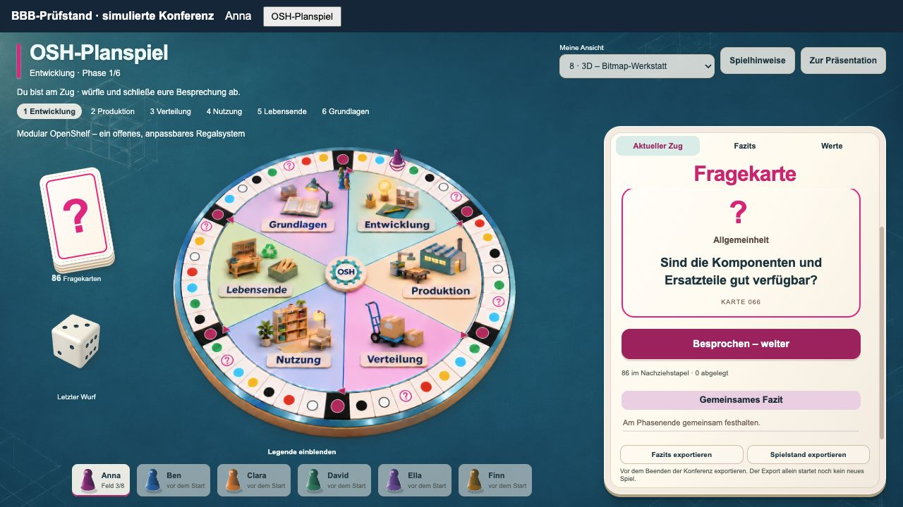
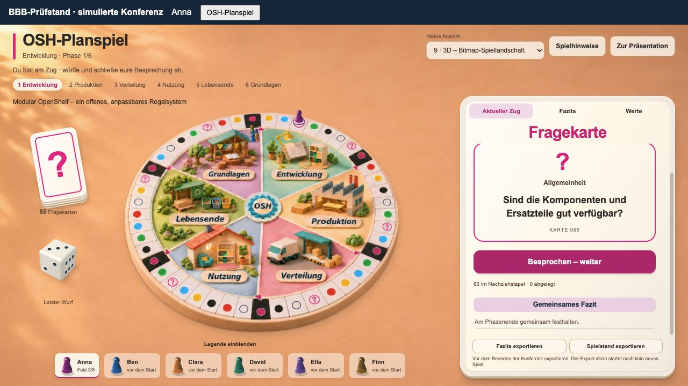

# Update: Verteilung und acht getrennte Spielfelder

> Betriebsangaben sind anonymisierte Beispiele. [Platzhalter und Übertragung auf eine eigene Instanz](datenschutz-und-betriebsbeispiele.md) vor der Ausführung beachten.

Stand: **6. November 2026** · **0.1.0-pilot.10** · lokal geprüft und auf dem BBB-Server bereitgestellt; Aktivierung noch offen.

## Korrektur

Der bisherige Sektor „Vertrieb“ heißt jetzt **Verteilung**. Die Bezeichnung wurde in Spieldaten, Phasenleiste, Kartenhinweisen, Fazits, Exporten, allen drei 2D-Spielplänen, allen drei Bitmap-Spielplänen und den aktuellen Anleitungen geändert. Die technische Kennung `distribution` bleibt stabil.

In den Bitmap-Ansichten **7–9** wurden die fehlerhaften Feldabstände korrigiert. Der Sektor hat acht getrennte Felder in dieser Reihenfolge: **Grün, Blau, Gelb, Rot, Fragezeichen, Weiß, Schwarz, Phasenabschluss**. Fragezeichen und weißer Kreis liegen jeweils mittig auf einer eigenen Kachel. Die 24 betroffenen Figurenanker wurden neu vermessen; ein angrenzender Werkstattanker wurde um wenige Pixel nachgeführt.

Jeder der sechs Sektoren entspricht fachlich **einem Sechstel des Spielplans**, mit acht Feldern. Die 2D-Grafiken zeichnen je 60° exakt. Die drei perspektivischen Bitmap-Illustrationen wurden gegen das vom Nutzer bestätigte Werkstattbild geprüft. Eine projektive Plausibilitätsprüfung ergab Abweichungen auf dem Niveau der Referenz und innerhalb der Ableseunsicherheit; sie ist kein Nachweis mathematisch exakter Rasterwinkel. Die sichtbaren Grenzen und die runde Außenkontur bleiben stimmig. Die eingebauten Imagegen-Edits haben einige dekorative Innendetails leicht verändert.

## Browserbelege

Lokaler BBB-SDK-Prüfstand mit fiktiven Teilnehmern; keine native Live-Abnahme.







## Prüfungen und Dokumente

- 33 Anwendungstests, Typprüfung, Build und Paket erfolgreich; vier Installertests und Ruby-Syntax bestanden.
- Regressionstest der übergroßen Markerlücke scheiterte mit den alten Koordinaten und besteht mit den neuen. Labelprüfung erfasst Daten, Fazitexport und alle drei SVGs.
- Unabhängige Sichtprüfung aller drei Bitmap-Bretter und der tatsächlichen Browserintegration bestanden. Figuren auf Feld 1, 5 (Frage) und 6 (Weiß) sitzen auf dem richtigen Marker; keine abgeschnittenen neuen Felder. Browserkonsole ohne Warnungen/Fehler.
- [Bedienungsanleitung pilot.10 als PDF](../pdf/OSH-Planspiel_Bedienungsanleitung_Online_v0.1.0-pilot.10.pdf): sechs Seiten vollständig gerendert und visuell geprüft, aktueller Screenshot, eingebettete Schriften.
- [Spielpläne v0.2 als PDF](../pdf/OSH-Planspiel_Spielplaene_v0.2.pdf): drei A3-Seiten mit „Verteilung“ und „Fazit Verteilung“, neue PNG-/SVG-Exporte und Layoutprüfung. Historische Fassungen bleiben erhalten.

Die Bildquellen, Promptprotokolle, Registrierungsdaten und Generatoren liegen im Anwendungsprojekt unter `apps/osh-planspiel/designs/boards-3d/`, `designs/boards-v1/` und `tools/`. Das Dokumentationsrepo bleibt ohne App-Quellcode oder Installationspakete.

## Aktivierung

Auf dem BBB-Server liegt das geprüfte Paket unter `/srv/osh-planspiel-example/osh-planspiel-verteilung-20261106/`. Die zwölf installierten Dateien der Vorgängerversion pilot.9 wurden mit dem archivierten Release verglichen und stimmen überein.

```sh
cd /srv/osh-planspiel-example/osh-planspiel-verteilung-20261106
sha256sum -c SHA256SUMS
sudo python3 -I install-pilot.py install
```

Der Installer prüft den Zielraum Beispielraum A und aktiviert das neue Manifest für künftige Konferenzen. Er startet weder BBB noch eine Konferenz neu. Eine laufende Konferenz behält ihre bisher geladene Version; die neuen Spielpläne werden mit einer anschließend gestarteten Konferenz geladen. Native Live-Abnahme von pilot.10 steht noch aus.

Rückweg zur nachgewiesenen pilot.9:

```sh
sudo python3 -I /srv/osh-planspiel-example/osh-planspiel-verteilung-20261106/install-pilot.py rollback
```

[Bedienung](osh-planspiel-bedienungsanleitung-online.md) · [How-to](osh-planspiel-implementierung-howto.md) · [Quellstand](quellstand-und-pruefungen.md)
