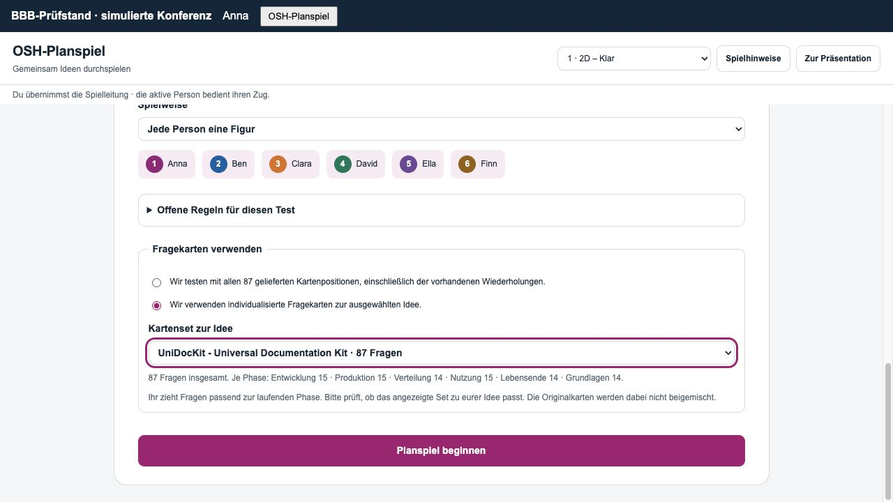

# Vier neue Kartensets für beide Konferenzräume

> Betriebsangaben sind anonymisierte Beispiele. [Platzhalter und Übertragung auf eine eigene Instanz](datenschutz-und-betriebsbeispiele.md) vor der Ausführung beachten.

Stand: **10. November 2026** · App **0.1.0-pilot.13** · lokal geprüft; Aktivierung auf dem Server und native BBB-Abnahme noch offen.

## Fragen und Grundlage

Die vier zusätzlich gespeicherten Ideen erhalten jeweils **87 unterschiedliche Fragen**, insgesamt **348 neue Karten**. OpenShelf und UniProKit Maxi bleiben einschließlich aller Kartenkennungen, Fragen, Rollen und Phasen unverändert bei jeweils 47 Fragen. Auch die 87 ursprünglichen Kartenpositionen bleiben unverändert.

| Idee | Vollständige Fragenliste | Anzahl |
| --- | --- | ---: |
| Modulares USB-C Werkzeug-Akku-System | [Fragen lesen](karten/usb-c-werkzeug-akku-v1.de.md) | 87 |
| Kindergarten Laubkompost | [Fragen lesen](karten/kindergarten-laubkompost-v1.de.md) | 87 |
| Verteilte OSEG Ideenplattform mit Ideenwebseiten | [Fragen lesen](karten/oseg-ideenplattform-v1.de.md) | 87 |
| UniDocKit – Universal Documentation Kit | [Fragen lesen](karten/unidockit-v1.de.md) | 87 |

Die Titel und Beschreibungen wurden nach dem vom Nutzer ausgeführten Leseaufruf aus beiden Raumlisten übernommen. In **Beispielraum B** waren Akku, Laubkompost und Ideenplattform bereits ausführlicher beschrieben. Diese Fassungen bilden die Grundlage der neuen Fragen; UniDocKit ist in beiden Räumen gleich beschrieben. Die Originalbeschreibungen stehen am Anfang der jeweiligen Fragenliste. Die Ideenbestände werden weder überschrieben noch erneut zwischen den Räumen synchronisiert.

Die Fragen sind neu formulierte Diskussionsimpulse. Beim Akku werden Zahlenbeispiele, elektrische Kompatibilität und Ladeversprechen als zu prüfende Entwurfsannahmen behandelt. Es handelt sich nicht um eine bestätigte technische Auslegung. Beim Laubkompost umfassen die Phasen auch pädagogische Beteiligung und Pflege; bei der Ideenplattform Umsetzung, Veröffentlichung, Nachnutzung und Archivierung. Lösungen werden nicht vorgegeben.

## Phasenverteilung

| Phase | Je neues Set | OpenShelf / UniProKit Maxi, unverändert |
| --- | ---: | ---: |
| Entwicklung | 15 | 8 |
| Produktion | 15 | 8 |
| Verteilung | 14 | 8 |
| Nutzung | 15 | 8 |
| Lebensende | 14 | 8 |
| Grundlagen | 14 | 7 |
| Gesamt | 87 | 47 |

Alle elf vorhandenen Rollen sind in jedem Set vertreten. Rollen sind Blickwinkel der Fragen, keine festen Spielerrollen. Ein Set wird gemeinsam gemischt; Fragefelder und freiwillige Zusatzfragen ziehen ausschließlich noch nicht verwendete Karten der aktuellen Phase. Leere Phasenvorräte werden nicht mit anderen Phasen aufgefüllt. Eine Partie muss nicht sämtliche Fragen verbrauchen.

## Auswahl in der App

Unter der bisherigen Originalkartenoption steht **„Wir verwenden individualisierte Fragekarten zur ausgewählten Idee.“** Die Set-Auswahl enthält jetzt alle sechs Ideen und deren jeweilige Fragenanzahl. Darunter zeigt die App die Verteilung auf die sechs Phasen.

Die vier gespeicherten neuen Ideen werden anhand ihrer stabilen Ideenkennung erkannt, die in beiden Räumen vorhanden ist. Dadurch bleibt die Vorauswahl auch bei einem geänderten Titel erhalten. Bei kopierten Ideen mit neuer Kennung kann der unveränderte Titel das Set vorschlagen; „UniDocKit“ wird auch als Kurzform erkannt. Eine unbekannte Idee benötigt eine ausdrückliche Auswahl. Die Spielleitung kann die vorgeschlagene Zuordnung ändern und sollte sie vor dem Start prüfen. Die App erzeugt keine neuen Fragen aus bearbeiteten Beschreibungen.



## Implementierung und Verträglichkeit

- Vier neue Dateien unter `content/personalized/`, je eine feste Set-Version und eine lesbare Markdown-Fragenliste. Die beiden bisherigen Dateien bleiben bytegleich.
- `src/card-sets.ts` registriert sechs individuelle Sets, löst alle Karten auf und ergänzt Vorschläge anhand Ideenkennung oder Titel.
- `src/app.tsx` zeigt Anzahl und Phasenverteilung aus den Daten; die bisher fest eingetragene Zahl 47 entfällt aus der allgemeinen Option.
- `release.json` enthält alle sechs individuellen Sets mit ihren Anzahlen und Phasenverteilungen. Die Karten sind im JavaScript gebündelt; kein zusätzlicher Serverdienst und kein Laufzeit-KI-Aufruf.
- Ereignisprotokoll 3 und das gespeicherte Ideenformat bleiben gleich. Die alten Set-IDs bleiben erhalten, damit deren Partien unverändert wiederhergestellt werden können. Neue Sets benötigen die neue App-Fassung.

## Update von Beispielraum A und Beispielraum B

Beide Räume sind bereits für pilot.12 und die Ideenverwaltung eingerichtet. Für diesen Stand wird **`update-rooms.py`** verwendet. Der ältere Einraum-Installer `install-pilot.py` prüft eine inzwischen erweiterte Ideen-Konfiguration noch bytegenau und ist für dieses Update nicht der passende Einstieg.

Auf dem BBB-Server:

```sh
cd /srv/osh-planspiel-example/osh-planspiel-kartensets-20261110
sha256sum -c SHA256SUMS
sudo python3 -I update-rooms.py check
sudo python3 -I update-rooms.py apply
```

`apply` enthält die Vorprüfungen bereits. Der Aufruf prüft SDK, vorhandene Raumidentitäten, beide Ideen-Zuordnungen und den laufenden Ideen-Dienst. Er legt die neuen statischen Dateien unter einem unveränderlichen Versionspfad ab und vergleicht sie über HTTPS. Erst danach werden die Plugin-Verweise beider Räume in **einer Datenbanktransaktion** ersetzt. Die echten MeetingStarter-Parameter werden geprüft, ohne eine BBB-Konferenz zu erzeugen. Ein zwischenzeitlich geänderter Raumwert stoppt die Übernahme.

Andere Apps und deren Einstellungen bleiben erhalten. Der Ideen-Dienst, seine Konfiguration, die gespeicherten Ideen und die Standard-Pins werden nicht verändert. Es gibt keinen BBB-, Greenlight- oder Dienstneustart; laufende Konferenzen werden nicht beendet. Die neue Fassung gilt nach dem regulären Ende und erneuten Start der jeweiligen Konferenz. Ein Browser-Reload derselben Konferenz reicht nicht.

Das Journal unter `<UPDATE_JOURNAL_DIR>/cards-*` enthält die vorherigen Raumwerte sowie den bestätigten Transaktionsstand. Das lesbare Ergebnis liegt unter `/srv/osh-planspiel-example/osh-planspiel-card-update.json`. Die Dateibereitstellung und die Raumtransaktion sind getrennte Schritte: Ein Fehler vor der Aktivierung kann bereits geprüfte statische Dateien zurücklassen. Bei einem späteren Fehler dient `committed.json` zur Klärung, ob die Raumtransaktion schon gespeichert wurde.

Rückweg für beide Räume zur installierten pilot.12, nach Hash- und HTTPS-Prüfung ihrer zwölf Dateien:

```sh
sudo python3 -I /srv/osh-planspiel-example/osh-planspiel-kartensets-20261110/update-rooms.py rollback
```

## Prüfung

- 44 TypeScript-Tests sowie Typprüfung, Build und Paketierung bestanden. Vollständige Spiele über alle sechs Phasen mit allen sechs individuellen Sets, keine fremden Phasenkarten oder Wiederholungen, Wiederherstellung und Titel-/ID-Zuordnung geprüft.
- Je 87 eindeutige Fragen, korrekte Rollen und Verteilung 15/15/14/15/14/14 für die vier neuen Sets. Alle 348 neuen Fragetexte sind auch untereinander unterschiedlich. Hashprüfung bestätigt unveränderte OpenShelf-/Maxi-Dateien.
- Sechs bestehende Installertests, sechs Tests des Zwei-Raum-Updates und vier Ruby-Tests mit 15 Assertions bestanden. Paketinhalt und zwölf Rückweg-Prüfsummen gegen das archivierte Release geprüft.
- Browser: alle sechs Set-Vorauswahlen, unveränderte 47er-Anzahlen, Start mit 87 UniDocKit-Karten, passende Entwicklungsfrage, später Beitritt und Neuladen sowie unabhängige Vorbereitung im zweiten Testraum geprüft. Auswahl auch im 620-Pixel-Inhaltsbereich visuell geprüft.
- Server: alle drei übertragenen Paketdateien per SHA-256 bestätigt; eingebettetes Paket und Archiv stimmen überein. Alle zwölf Dateien der installierten pilot.12 sind mit dem Archiv und ihrer HTTPS-Auslieferung identisch.
- Der Aktivierungsversuch endet vor Ausführung des Updates mit `sudo: a password is required`. Die interaktive Aktivierung und vollständige native BBB-Abnahme stehen noch aus.

[Bedienung](osh-planspiel-bedienungsanleitung-online.md) · [How-to](osh-planspiel-implementierung-howto.md) · [Changelog](../CHANGELOG.md)
