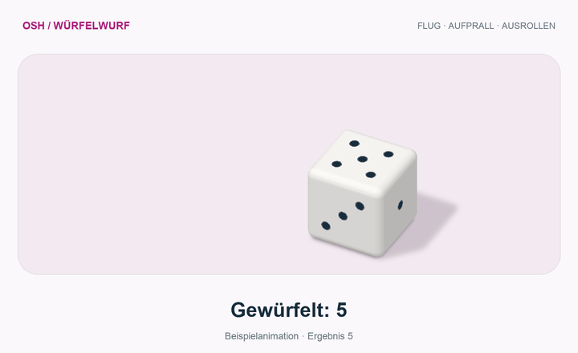

# Würfelanimation: Entwurf und Anbindung

Stand: **6. November 2026**. Die Animation wurde als Gestaltungsmuster erstellt und ist noch nicht in die App eingebaut.

## Entwurfsstand

Die ersten Varianten verglichen einen weißen Würfel, eine pinke Gestaltung und eine räumliche Drehung. Danach wurde ein vollständiger Wurf ergänzt: Flug ins Bild, Aufprallen, Hüpfen und Ausrollen. Die zweite Fassung korrigiert die Kameraperspektive und den Schatten, damit der Würfel am Ende flach auf seiner Unterseite liegt. Die 5 zeigt nach oben.

Die lokal vorhandenen GIF-/MP4-Muster sind 720 × 440 Pixel groß und dauern 4,36 Sekunden. Sie sind keine Zufallswürfel: Jede Beispieldatei endet absichtlich auf 5.

## Für die Integration erforderlich

- Das bestätigte Ergebnis aus dem BBB-Ereignis verwenden.
- Jedes neue Wurfereignis höchstens einmal animieren, auch bei derselben Zahl wie im vorherigen Zug.
- Beim späteren Beitritt oder Neuladen sofort das bereits feststehende Ergebnis anzeigen.
- Sechs korrekte Endlagen bereitstellen oder den Würfel parametrisch darstellen.
- Die Figur gegebenenfalls über einen lokalen Anzeigezustand erst nach dem Ausrollen sichtbar bewegen; der bestätigte gemeinsame Spielzustand bleibt erhalten.
- Bei reduzierter Bewegung und fehlenden Medien direkt das Ergebnis anzeigen.
- Zusätzliche Assets in Build, Paket, Installer und lokalem Prüfstand berücksichtigen.

Der konkrete Ansatz ist im [Implementierungs-How-to](osh-planspiel-implementierung-howto.md#beispiel-c-würfelanimation-anbinden) beschrieben. Erst nach Implementierung und Prüfung folgt ein App-Release mit Eintrag im Changelog.
